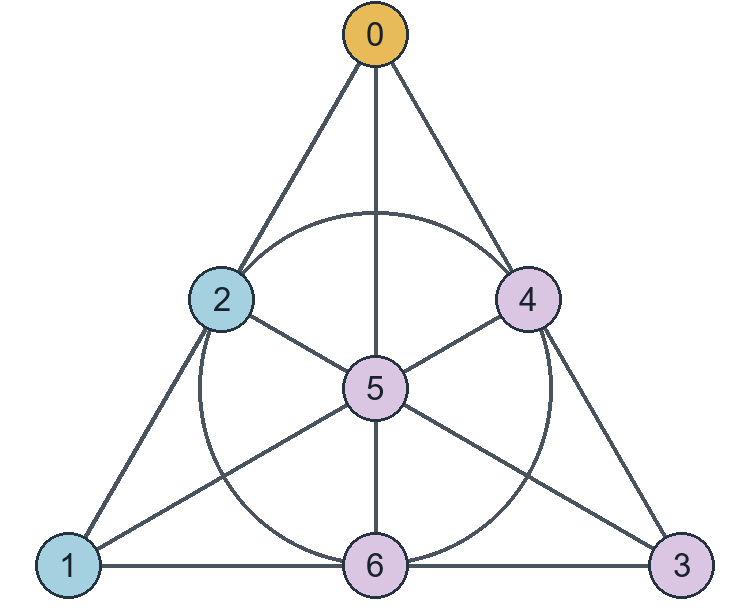

# The exact block-type spectrum in the Colbourn–Dinitz–Rosa problem

**Juan Pablo Traverso Gianini**  
Independent researcher, Santiago, Chile  
[jtraverso@gmail.com](mailto:jtraverso@gmail.com)  
[ORCID: 0009-0003-6068-4096](https://orcid.org/0009-0003-6068-4096)

**Paper I. Bicolorings of Steiner triple systems.**  
**Preprint 1.0 — 6 November 2026.**

## Abstract

In 1999 Colbourn, Dinitz and Rosa asked which three class sizes can occur. We ask a further question about the blocks of each such system. Fix three color classes in a Steiner triple system and require each block to meet exactly two of them. Of the six block-type counts, any one determines the other five. For sufficiently large admissible profiles, we characterize the possible values of the number of blocks with two points in the first class and one in the third. An integer occurs exactly when it passes two arithmetic tests obtained by counting pairs through a point. The proof uses the typed absorption theorems T and T+ of *Triangle decompositions III* [1]. In the interior T+ gives an approximate count and we select a set of reserved nine-point exchanges, each worth one unit. At an endpoint we place the scarce types first and apply T to the remaining pairs. Existence for every admissible order is proved separately in [2].

## 1. One free count

A Steiner triple system on $n$ points is a family of triples in which every pair occurs once. Fix a partition into three nonempty sets $A,B,C$, of sizes $a,b,c$. In a strict 3-bicoloring exactly two colors occur in each triple. Write $AAC$ for a block containing two points of $A$ and one of $C$. There are six types, since either of the two colors can be repeated.

Figure 1 gives a complete example. Its points are partitioned as $A=\{0\}$, $B=\{1,2\}$ and $C=\{3,4,5,6\}$. Follow the line through 0 and 1: its third point is 2. Follow the circle through 2 and 4: its third point is 6. Each of the seven curves carries one block. Their seven triples account for $7\cdot3=21=\binom72$ distinct pairs.

In 1999 Colbourn, Dinitz and Rosa posed Conjecture 2.7: realize each admissible three-class profile [3]. They constructed the permitted profiles below order 1000. Dinitz and Stinson later retained the unrestricted problem as their Conjecture 1.4 [4]. Here the class sizes are fixed and we keep track of which color is repeated in each block. This also distinguishes our spectrum from the set of numbers of colors a fixed system admits, studied for small systems by Gionfriddo, Guardo, Milazzo and Voloshin [5].

Set $t=N_{AAC}$. Every pair within $A$ is in an $AAB$ or an $AAC$ block. Every pair between $A$ and $C$ is in an $AAC$ or an $ACC$ block, and each such block accounts for two cross pairs. These two observations give the first row below. Applying the same counts to the other pairs gives the remaining rows in order.
$$
\begin{aligned}
N_{AAB}&=\binom a2-t, &N_{ACC}&=ac/2-t,\\
N_{ABB}&=ab/2-N_{AAB}, &N_{BBC}&=\binom b2-N_{ABB},\\
N_{BCC}&=bc/2-N_{BBC}, &N_{ACC}+N_{BCC}&=\binom c2.
\end{aligned}
$$
The last equality is a consistency check. After substitution it says that the number of same-color pairs equals the number of blocks. Writing $n=a+b+c$, its equivalent form is
$$a^2+b^2+c^2-ab-ac-bc=n.$$
Call the profile *admissible* if its entries are positive, this identity holds, $n\equiv1,3\pmod 6$, and no two entries are both 2. These are the class-size conditions of Colbourn, Dinitz and Rosa [3].

**Theorem 1 (exact spectrum).** There is an $n_0$ such that for every admissible $(a,b,c)$ of order $n\ge n_0$, an integer $t\ge0$ is the number of $AAC$ blocks of a system on the prescribed classes if and only if
$$
0\le t\le\binom a2,\qquad
L(a,b,c;t),\qquad L\left(a,c,b;\binom a2-t\right).
$$
Section 2 defines $L$ by integer arithmetic. Swapping $B$ and $C$ turns $AAB$ into $AAC$, so the two tests read the same obstruction from opposite ends.

Even integral, nonnegative answers to all six counts can fail. With $(a,b,c)=(4,6,9)$, the choice $t=0$ gives $(6,0,6,9,18,18)$ in the order $AAB,AAC,ABB,BBC,ACC,BCC$. Fix a point of $A$. Its nine pairs with $C$ are covered two at a time by $ACC$ blocks and one at a time by $AAC$ blocks. Thus at least one $AAC$ block must pass through this point. Summing over $A$ gives $2t\ge4$. This is a local obstruction at order 19. The sufficiency result below is uniform in the profile once the order is large.

## 2. Counting through a point

First look at a point in $A$. A block $AAB$ through it accounts for one neighbor in $A$ and one in $B$. A block $AAC$ accounts for one neighbor in $A$ and none in $B$. A block $ABB$ accounts for two neighbors in $B$ and none in $A$. Subtracting the two neighbor counts cancels the contribution from $AAB$. We will use this subtraction in each class.

Number the classes cyclically, with $(s_0,s_1,s_2)=(a,b,c)$ and indices modulo 3. For $u$ in class $i$ let $m_u$ count blocks of type $ii(i+2)$ containing $u$, and let $k_u$ count blocks in which $u$ is the singleton of type $(i+1)(i+1)i$. Let $h_u$ count the blocks $ii(i+1)$ through $u$. Counting first the neighbors in its own class and then those in the next class gives
$$s_i-1=h_u+m_u,\qquad s_{i+1}=h_u+2k_u.$$
Subtracting removes $h_u$. Put $\alpha_i=s_i-1-s_{i+1}$, so that $m_u=\alpha_i+2k_u$.

The blocks counted by $K_i$ have repeated class $i+1$ and singleton class $i$. Set $K_i=\sum_{u\in i}k_u=s_iq_i+r_i$, with $0\le r_i<s_i$, and put $d_i=\alpha_i+2q_i$. Each integer $k_u$ is at least $\lceil-\alpha_i/2\rceil$. Its average shares this lower bound, as does the floor $q_i$ of the average. Hence $d_i\ge0$. Summing $m_u$ in class $i$ counts each internal pair belonging to a block $ii(i+2)$ twice. There are $K_{i+2}$ such pairs, one per block. Therefore
$$s_id_i+2r_i=2K_{i+2}.$$

If $d_i=0$, all the $m_u=2(k_u-q_i)$ are even. The internal pairs just counted form a simple graph with these degrees and precisely $r_i$ edges. A nonempty simple graph of even degrees contains a cycle, which needs at least three edges. This explains the missing remainders 1 and 2.

**Definition.** $L(a,b,c;t)$ holds when there are nonnegative integers $d_i,q_i,r_i$ satisfying, for each $i$,
$$
\begin{aligned}
 r_i&<s_i, & d_i&=s_i-1-s_{i+1}+2q_i,\\
 s_id_i+2r_i&=2(s_{i+2}q_{i+2}+r_{i+2}),&
 d_i=0&\ \Longrightarrow\ r_i\notin\{1,2\},
\end{aligned}
$$
and $cq_2+r_2=t$. The last equation fixes the total with singleton in $C$ and repeated color $A$. To evaluate the test, start with $K_2=t$ and use $K_{i+2}=K_i+s_i\alpha_i/2$, which follows by substituting for $d_i$ in the preceding identity. Divide the resulting $K_i$ by $s_i$ and check the displayed conditions. Thus the criterion can be read directly from the input. The point counts prove necessity, first in the given order and then after interchanging $B,C$.

**Checking the test at order 19.** Return to $(4,6,9)$. The three differences $\alpha_i$ are $-3,-4,4$. Starting from $K_2=t$, the relation in the definition gives $K_1=t+18$ and then $K_0=t+6$. At $t=0$, dividing $K_0=6$ by 4 gives $q_0=1$, so $d_0=-3+2=-1$. The test rejects this value, exactly as the nine neighbors of each point of $A$ required. At $t=2$ the same division gives $q_0=2$, $r_0=0$ and $d_0=1$. This removes that particular obstruction. At order 19 the computation illustrates the necessary test; the sufficiency proof uses the large-order hypothesis.

## 3. The input from physical typed absorption

Identify a pair with an edge of the complete graph on the points. A realization is precisely a decomposition of its edges into triangles with the six allowed color patterns. We use Theorem T of Traverso Gianini [1] on this graph and on graphs obtained by removing pairs. Its hypotheses concern the graph on which the triangles will actually be chosen.

| Hypothesis of T | What to check in the graph |
|:--|:--|
| H1. Fractional covering | Give every allowed triangle a weight between $1/(Cn)$ and $C/n$. At each edge the weights must sum to one. |
| H2. Integer lattice | Write the edge vector of the graph as an integer combination of edge vectors of allowed triangles. Negative coefficients are permitted. |
| H3. Common neighbors | For each pair of distinct roots and prescribed admissible third class, find at least $\alpha n$ common neighbors in that class. |
| H4. Hinges | For each pair of allowed triangles sharing an edge, there is an order $6\le i\le h$ with at least $\alpha n^{i-4}$ hinges on exactly $i$ vertices. |

**Absorption input [1, §§1, 2.3].** We reproduce the two statements with their original equation numbers. Here $M_\mu(w)$ sums the seed weights against $w$ and $P_\mu$ sums the products of the four weights over Pasch configurations. The inputs are main_theorem_T and main_theorem_T_with_triangle_monitors_and_pasch.

**Theorem T.** Fix $I,\mathcal F,\alpha,C,h$ with $\alpha>0$, $C\geq1$ and $h\geq6$. There is an integer $n_0$ such that every labelled graph G of order $n\geq n_0$ satisfying H1–H4 has an allowed triangle decomposition.

**Theorem T+.** Fix $I,\mathcal F,\alpha,C,h$ as in Theorem T, together with $\eta>0$ and an integer $q\geq0$. There is an integer $n_0$ such that the following holds for every labelled graph G of order $n\geq n_0$ and every specified seed $\mu$ satisfying H1, provided H2–H4 hold. For every finite family $(w_j)_{j\in\mathcal J}$ with

$$
|\mathcal J|\leq n^q,
\qquad |w_j(Q)|\leq1\quad(j\in\mathcal J,\ Q\in\mathcal T),          \tag{2.9}
$$

there is one allowed triangle decomposition $\mathcal D$ such that

$$
\left|\sum_{Q\in\mathcal D}w_j(Q)-M_\mu(w_j)\right|
\leq\eta n^2\qquad(j\in\mathcal J),                                \tag{2.10}
$$

and

$$
|P(\mathcal D)-P_\mu|\leq\eta n^2.                                \tag{2.11}
$$

This spectrum proof states an existential threshold. The numerical cutoffs for individual lemmas below do not evaluate the threshold in T or the Pasch version of T+.

### 3.1. Constructing the weights

Write $w_{AAC}$ for the weight of each triangle of that type. An internal $CC$ edge has $a$ possible third points in $A$ and $b$ in $B$. Assign half its load to each class by setting $w_{ACC}=1/(2a)$ and $w_{BCC}=1/(2b)$. Now fix an $AC$ edge. Its third point can be one of the other $a-1$ points of $A$ or one of the other $c-1$ points of $C$. Solving its load equation, and then doing the same for $BC$, gives
$$
w_{AAC}=\frac{1-(c-1)/(2a)}{a-1},\qquad
w_{BBC}=\frac{1-(c-1)/(2b)}{b-1}.
$$
The internal $AA$ and $BB$ edges now determine the last two weights:
$$
b w_{AAB}=1-cw_{AAC},\qquad a w_{ABB}=1-cw_{BBC}.
$$
Only the $AB$ load remains to be checked. Each triangle contributes twice as much load to cross pairs as to internal pairs. By the profile identity this is also the ratio of the numbers of such pairs. Every edge outside $AB$ already has load one, and all $AB$ edges have equal load, so their load must be one as well. The estimate for these six weights in the seed lemma is $1/(4n)\le w\le4/n$ for $n\ge400$. It uses $(a-b)^2+(b-c)^2+(c-a)^2=2n$, which forces each class size to be $n/3+O(\sqrt n)$.

### 3.2. The integer condition and the local exchanges

Two of these verifications can be seen directly on edge vectors. For H2 take the quotient of the free abelian group on edges by the vectors of allowed triangles. In this quotient every allowed triple gives $[xy]+[xz]+[yz]=0$. Each class has at least three points. For example, fix two points $w,w'$ outside a class and let $D_x=[xw]-[xw']$ for points $x$ in it. Subtract the triangle relations for $xyw$ and $xyw'$: this gives $D_x+D_y=0$ for all distinct $x,y$ in the class. Taking a third point shows that $D_x=D_y$ and $2D_x=0$. This is why a term of order at most two occurs in the lattice calculation. Fix representatives $o_i$ in the three classes. For $u$ of color $i$, put $e_u=[uw]-[o_iw]$ with $w$ outside class $i$. The identity for $D_x$ just proved shows that the difference is independent of $w$: subtracting its values at $w,w'$ gives $D_u-D_{o_i}=0$. Choose two distinct external points $w,w'$ of the same other class. Subtract the relations for $uww'$ and $o_iww'$ to obtain $e_u+e_u=0$. On a cross edge $uv$, subtract the representatives one endpoint at a time. This gives $[uv]=[o_io_j]+e_u+e_v$. On an internal edge use $[uv]=-[uw]-[vw]$ and $2e_w=0$. Its constant term is $-2[o_io_j]$, independent of the other color $j$. The three doubled cross constants therefore agree; call their value $\gamma$. Summing over all pairs kills each $e_u$, since it occurs $n-1$ times. The remaining coefficient of $\gamma$ is
$$\tfrac12(ab+bc+ca)-\binom a2-\binom b2-\binom c2.$$
Since $n$ is odd, either one or three sizes are odd; the quadratic identity rules out three. Thus each cross product is even, and the coefficient vanishes by the profile identity. This gives membership in the physical lattice before any system has been constructed.

For H4 let $uva,uvb$ be two allowed triangles on four distinct points (here $a,b$ denote vertices). Choose fresh $x,y$ in the classes of $u,v$ respectively. Set $J=\{uy,xv,xy,xa,xb,ya,yb\}$. Adjoin $ua,va$ to $J$: the nine edges split as $uya,xva,xyb$. Adjoin $ub,vb$ instead: they split as $uyb,xvb,xya$. Each triangle has one of the original two color patterns. Distinct choices give at least $n^2/32$ hinges in the complete graph. In the residual graph we make the same construction after excluding points that lost a required adjacency.

**Proposition 3.2 (the complete host).** Every sufficiently large admissible profile has a realization. *Proof.* For H3 we can use every point of the prescribed class except the roots. For $n\ge400$ each class contains at least $n/4+2$ points. Together with the hinge count above this gives H3 and H4 with $\alpha=1/32$ and hinge order 6. Take the larger of 400 and the threshold of T [1] for these parameters and $C=4$. Sections 3.1 and 3.2 give its four hypotheses. T now partitions every edge into an allowed triangle. Keeping those triangles as blocks gives exactly one block through each pair, with the original classes.

In H3 the two distinct points may be nonadjacent: the requirement applies whenever their two labels and the proposed third label form an allowed multiset.

### 3.3. What changes when pairs are reserved

For the exact spectrum we must set some pairs aside before applying absorption. Keevash's partite decomposition theorem [6, Theorem 5.15] provides a general large-order existence criterion. Here we need to control how many triangles of one particular type the completion adds. T+ [1] estimates this count from the weights: for the indicator of $AAC$, the count differs from its weighted sum by at most $\eta n^2$.

Deleting pairs changes H1. Let $\mathsf A$ send triangle weights to their edge loads. If a candidate seed gives loads $\mathsf A\mu$, the correction must solve $\mathsf A z=\mathbf1-\mathsf A\mu$ on the surviving edges. On a triangle vector there are two cross pairs for every internal pair. Thus any edge load in the image satisfies $\sum_{\rm cross} f=2\sum_{\rm internal} f$. The desired load satisfies the same equality by admissibility and subtraction of the reserved triangle vectors. The error therefore lies in the subspace on which the inverse is defined. The bounded inverse lemma for the six types controls the correction on the complete graph by a constant times the maximum load error divided by $n$. After sparse deletion one restricts a correction to surviving triangles and corrects the new, smaller error. Geometric convergence gives an exact seed; the bound on the total correction preserves positivity. This use of an inverse and a perturbation estimate has precedents in fractional decompositions [7,8]. For a restricted set of types one must identify the subspace of loads on which the equation is solvable. That distinction matters at an end of the spectrum.

**Lemma 3.3 (six-type inverse; bri_of_balanced).** If all three class sizes are at least $m\ge512$ and $n\le4m$, every real load $f$ on the pairs with cross-pair sum twice its internal-pair sum has a linear lift to allowed triangle weights $z$, with $\mathsf A z=f$ and $\|z\|_\infty\le52000\|f\|_\infty/n$. The construction and the two norm estimates are worked out in Appendix A.

To see where 52000 comes from, write $W$ for the subspace of balanced loads. The approximate lift $\Phi_0$ satisfies $\|\Phi_0 f\|_\infty\le26000\|f\|_\infty/n$ on $W$. Its error after summing weights at each edge is at most $\|f\|_\infty/2$. Thus $F=\mathsf A\Phi_0$ maps $W$ into itself and $\|Ff\|_\infty\ge\|f\|_\infty/2$. In finite dimension this makes $F$ invertible on $W$. The exact lift $\Phi_0 F^{-1}$ therefore costs at most twice the approximate bound. The estimates for $\Phi_0$ are norm_err_le in BRIAssembly and abs_Phi0_le in BRIFinal, under CDRBicolour/Absorption in the shared source archive.

## 4. Removing the error one block at a time

Suppose each of the six required counts is at least $\delta n^2$, for fixed $\delta>0$. Label nine points $0,1,2$ in $A$, $3,4,5$ in $B$ and $6,7,8$ in $C$. In the table each string denotes a triple. The two rows are alternative decompositions of the same pairs.

| Choice | Triples, grouped by their first point | $AAC$ |
|:--|:--|--:|
| Low | 015, 023, 067; 127, 134, 168; 356, 378, 458 | 1 |
| High | 016, 027, 035; 123, 145, 178; 348, 367, 568 | 2 |

For instance, the low triple 015 uses pairs 01, 05 and 15, which appear in the high triples 016, 035 and 145. Expanding the other eight triples in the same way gives the same 27 distinct pairs on both sides. The low row has the single $AAC$ triple 127. The high row has 016 and 027. Switching rows preserves the covered graph and changes $t$ by one.

**Lemma 4.1 (copy_edge, degL_leave).** For every prime $m>8$ with $\min(a,b,c)\ge3m$, one can reserve $m^2$ edge-disjoint copies of the displayed trade. Either choice covers the same edges in each copy. The union has maximum degree at most $81m$, a convenient upper bound. Since $m$ is odd, the target $m_0=t-3m^2/2$ below is a real half-integer; only the number of high choices must be integral.

The prime and the tolerance can be chosen in the right order. Write $K=52000$, $C_0=64+2/\delta$, and fix $\lambda=1/(10^9 C_0^2)$ and $\eta=\lambda^2/16$ before taking the threshold of T+. For $n$ large let $r=\lfloor\lambda n\rfloor$. Bertrand's postulate gives $r<m\le2r$; thus $m$ is large enough for the construction, $3m\le\min(a,b,c)$ and $\eta n^2\le m^2/4$. Since each type count is affine in $t$ with slope $1$ or $-1$, moving $t$ by at most $\delta n^2/2$ retains at least half the initial margin in every type. The shifts below have size at most $3m^2/2+2(4K+1)C_0\,81mn$; substituting $m\le2\lambda n$, $K=52000$, $C_0\ge64$ and $1/C_0\le\delta/2$ puts them within that margin.

We will need a whole family of seeds on the complete graph. Substitute a real number $\tau$ for $t$ in the six pair counts of Section 1 and call the resulting masses $N_X$. If type $X=iij$ has class sizes $s_i,s_j$, there are $T_X=\binom{s_i}{2}s_j$ available triples. Give each of them weight $N_X/T_X$. The mass on $AAC$ is then exactly $\tau$. The six equations of Section 1 give total load equal to the number of pairs in each pair class. Permuting vertices within each class is transitive on its pairs and preserves the weights, so every pair has load one. For the two choices of $\tau$ below the available margin gives $N_X\ge(\delta/2)n^2$. Also $N_X\le n^2/2$ by the internal-pair count, and $n^3/128\le T_X\le n^3$ since each class has at least $n/4+2$ points. Dividing these bounds gives weights between $1/(C_0 n)$ and $C_0/n$ for $C_0=64+2/\delta$. This is the family constructed in SeedCounts.

The trade placement lemma embeds $M=m^2$ pairwise edge-disjoint copies, for a prime $m$ of order $\lambda n$ with $\lambda$ sufficiently small relative to $\delta$. To see why the copies do not share pairs, assign a separate pool of $m$ points to each of the nine positions. Copy $(s,z)$ uses point $s+iz$ of pool $i$, with arithmetic modulo $m>8$. Agreement in pools $i\ne j$ gives $(i-j)(z-z')=0$, so $z=z'$ and then $s=s'$. Delete the common edge sets of the copies. With all low choices the reserved part contributes $M$ blocks of the counted type; with all high choices it contributes $2M$. Aim for the midpoint on the residual graph, namely $m_0=t-3M/2$. Here is how we obtain that mass after deleting the reserved edges. Write $\Delta=81m$ for the bound on the deleted degree, $K=52000$ for the six-type inverse bound and $C_0=64+2/\delta$. Correcting a full-graph seed of mass $\tau$ gives a residual mass $b_\tau$ satisfying
$$ |b_\tau-\tau|\le E,\qquad E=(4K+1)C_0\Delta n. $$
The deleted triangles have total seed mass at most $C_0\Delta n/2$. At a surviving edge at most $2\Delta$ possible third points have been lost, so its load deficit is at most $2\Delta C_0/n$. The inverse bound and the geometric-series factor two from Appendix A give total correction mass at most $4KC_0\Delta n$. Their sum is at most $(4K+1)C_0\Delta n$, as claimed. In the placement lemma $\lambda=1/(10^9 C_0^2)$ is chosen before $n$; this leaves enough of the margin $\delta n^2$ to use both $\tau_-=m_0-2E$ and $\tau_+=m_0+2E$. Applying the estimate twice gives
$$ b_{\tau_-}\le m_0-E,\qquad b_{\tau_+}\ge m_0+E. $$
Set $s=(m_0-b_{\tau_-})/(b_{\tau_+}-b_{\tau_-})$. Then $0\le s\le1$. Give the two corrected seeds coefficients $1-s,s$. At every surviving edge their combined load is $(1-s)+s=1$, their weight bounds persist, and their combined $AAC$ mass is exactly $m_0$.

Apply T+ to the indicator of $AAC$. Choose its tolerance so that the residual count $D$ satisfies $|D-m_0|\le M/4$. Take the high row on exactly $k=t-M-D$ copies. This is an integer and
$$k=M/2+(m_0-D)\in[M/4,3M/4].$$
There are enough copies for either choice. The completed system has $D+(M-k)+2k=t$ counted blocks. This is the step from the approximate conclusion of Paper III to the exact one here.

## 5. When three types are scarce

**Lemma 5.1 (exists_graph).** If $4d+64\le s$, $0\le r<s$, odd $d$ implies even $s$, and $d=0$ implies $r\notin\{1,2\}$, there is a simple graph on the cyclic positions $0,\ldots,s-1$ with degree $d+2$ on the first $r$ consecutive positions and $d$ elsewhere.

**Lemma 5.2 (lower_packing).** Given an admissible profile and witnesses to $L$, assume $4d_i+64\le s_i$ and $d_i+3\le s_{i+2}$ in each class. There is a packing of minority blocks with exactly $cq_2+r_2$ blocks of type $AAC$. At each point of class $i$, for some $e\in\{0,1\}$, its covered degrees towards $i,i+1,i+2$ are respectively $d_i+2e,2(q_i+e),d_i+2e$. The even degree sum $s_i d_i=2K_{i+2}-2r_i$ gives the parity required in Lemma 5.1.

**Lemma 5.3 (physical_maj).** Suppose every class occurs and every four points (allowing repetitions) have a common residual neighbor of each prescribed class. If at every point the internal and forward degrees agree and the backward degree is even, the residual edge vector lies in the integer lattice generated by the surviving majority triangles.

**Lemma 5.4 (corner_residual_seed).** For an admissible profile with $n\ge10^{24}$, remove any set of pairs of maximum degree $\Delta$ with $10^{13}\Delta\le n$. If the remaining internal and forward degrees agree at every point, the majority triangles admit an exact diffuse seed with constant 8.

Near the lower end, a seed with slack in all six types may be unavailable. Instead place every block of each type $ii(i+2)$ before asking T to cover any remaining edge. Here are the hypotheses and outputs of the planting lemma. Assume the integer relations of $L$ and $10^{15}(d_i+q_i+1)\le n$ in each class. Within class $i$ build a simple graph with $r_i$ vertices of degree $d_i+2$ and the rest of degree $d_i$. Its degree sum is $s_id_i+2r_i=2K_{i+2}$, the exact number of endpoints required. At base degree zero the exceptional remainders from Section 2 are precisely the one- and two-edge obstructions. We use Vizing's edge coloring theorem and equitable rebalancing [9,10]. A proper equitable edge coloring assigns the singletons in class $i+2$ to the internal edges. Properness prevents a cross pair from being used twice. The classes of this edge coloring have sizes $q_{i+2}$ or $q_{i+2}+1$. Relabeling them aligns the larger loads with the designated higher-degree vertices in that class. The three graphs then give an edge-disjoint packing with the prescribed minority counts.

**How the internal graph is built.** Place the $s_i$ vertices on a cycle. Joining each vertex to those at offsets $\pm j$ adds two to every degree for each chosen offset $0<j<s_i/2$. When the order is even a diameter matching can add one more. To raise $r_i\ge3$ selected degrees by two, use a cycle on those vertices, ordered first by increasing even position, then by decreasing odd position. Its steps have length one or two, so the base circulant can leave those steps free. For one or two selected vertices a cycle is unavailable. The graph lemma instead replaces an edge $xy$ by $xu,uy$ with both new edges free: $x,y$ keep their degrees and $u$ gains two. This needs a base edge, which explains exactly why $d_i=0$ is exceptional. The graph lemma makes the edge choices disjoint under the smallness hypothesis. Once the graphs are built, proper coloring assigns their edges to singleton vertices without reusing a pair.

Consider a vertex $u$ in class $i$ with singleton load $k_u$ and internal degree $m_u=\alpha_i+2k_u$. After planting, it has $s_i-1-m_u$ neighbors left in its own class and $s_{i+1}-2k_u$ in the next. These numbers are equal. Its total remaining degree is even: the original degree was $n-1$ and each planted triangle through $u$ removed two edges. Subtracting the two equal neighbor counts leaves an even degree into the previous class, as required for edges covered two at a time when $u$ is the singleton. The majority-lattice lemma gives H2 from precisely this balance and parity in the dense residual graph.

The lattice calculation explains the two residual conditions. In the quotient by majority triangles, the lattice lemma writes the class of an internal edge $uv$ as $-\phi(u)-\phi(v)$ and that of a forward edge $uv$ from $i$ to $i+1$ as $\phi(u)+\psi(v)$, where $2\psi(v)=0$. At a vertex the coefficient of $\phi$ is its forward degree minus its internal degree; these are equal. The coefficient of $\psi$ is its backward degree; this is even. Summing the edge classes therefore gives zero in the quotient, exactly H2.

For H1, give each majority triangle $ii(i+1)$ the preliminary weight $1/s_{i+1}$. On the complete graph an internal edge then has load one: its third point has $s_{i+1}$ choices. A cross edge from $i$ to $i+1$ has load $(s_i-1)/s_{i+1}$, by its $s_i-1$ choices in $i$. The discrepancy is $O(n^{-1/2})$. After planting one uses the inverse for the *three* majority types on the balanced subspace. The residual-seed lemma gives exact weights with constant 8 when the deleted degree is at most $n/10^{13}$ and $n\ge10^{24}$. The planting estimates give this degree bound. Each prescribed class still has linearly many available points after excluding roots and neighbors lost to deletion, giving H3 and the two free vertices for H4. T now decomposes the residual graph using only majority types. It can add no $AAC$ block, so all $t$ planted ones survive with their count unchanged.

### 5.1. Why the three cases cover all admissible counts

If the planting bound holds, the preceding argument finishes the lower end. Apply the same test with $B,C$ exchanged. A construction in that order gives $\binom a2-t$ blocks with the other singleton color, and hence $t$ in the original order. It remains to show that when the planting bound fails in both orientations, we have enough of every type for Section 4.

**Lemma 5.5 (large_counts_R, profile specialization).** For any admissible profile of order $n\ge10^{40}$ satisfying $L$, if $10^{15}(d_j+q_j+1)>n$ for some $j$, all three associated counts satisfy $K_i\ge n^2/10^{17}$. *Proof.* Take $n\ge10^{40}$ in this estimate. Since $(s_i-s_{i+1})^2\le2n$, we have $|\alpha_i|\le\sqrt{2n}+1\le n/10^{17}$. Failure at a class $j$ means $n<10^{15}(d_j+q_j+1)$. Substitute $d_j=\alpha_j+2q_j$. Using the preceding bound and $1\le n/10^{17}$ gives $3q_j>n/10^{15}-2n/10^{17}$, hence $q_j\ge n/(6\cdot10^{15})$. Since $s_j\ge n/4$, we have $K_j\ge n^2/(24\cdot10^{15})$.

Now apply $K_{i+2}-K_i=s_i\alpha_i/2$. In one step we lose at most $n^2/(2\cdot10^{17})$; in two steps we reach either of the other classes. Thus each of the three counts satisfies
$$ K_i\ge\frac{n^2}{24\cdot10^{15}}-\frac{n^2}{10^{17}}\ge\frac{n^2}{10^{17}}. $$
The other orientation gives the same bound for the other three types. Section 4 therefore applies with $\delta=10^{-17}$. Choose the order above all the thresholds used in these constructions. This proves sufficiency; Section 2 proved necessity. Together they prove Theorem 1.

## 6. Further prescriptions

**Theorem 6.1 (cdr_completion).** Lindner and Rosa studied the possible *sizes* of the common block set of two systems [11]. Here we fix the partition and prescribe the common blocks themselves. Let $P$ be any edge-disjoint packing of allowed triangles and let $\Delta$ be the maximum degree of the graph of pairs already covered. For large admissible profiles, $6656000\Delta\le n$ suffices to complete $P$: the residual-seed estimate supplies H1, and the residual quotient calculation in Appendix B gives H2. The typed neighbor and hinge counts withstand this deletion. Adding $P$ to the residual decomposition covers every pair once. 

**Theorem 6.2 (cdr_prescribed_intersection).** For the same prescribed classes a separate refinement gives constants $K,n_0$ for which $n\ge n_0$ and $K\Delta\le n$ suffice for two completions to have intersection *exactly* $P$. The construction subdivides the color classes and completes the remainder twice with disjoint sets of allowed refined types. A common block outside $P$ would then have to belong to both sets. The complete proof of this refinement is formal; Appendix B identifies its declaration and dependencies.

**Theorem 6.3 (cdr_many_pasch_counts).** A Pasch consists of four blocks on six points, each point occurring twice. For every fixed $k$ and all sufficiently large admissible profiles there are $k$ realizations with pairwise distinct Pasch counts. Along a balanced perturbation of a seed, the weighted Pasch target is $A_0+A_2z^2+A_4z^4$, with $A_4\ge n^2/40^6$. As a function of $z^2$ this is a quadratic. On a suitably spaced grid of $2k+1$ points one obtains $k$ values separated by a positive multiple of $n^2$ depending on $k$. Choose the Pasch tolerance in T+ below half that separation. The actual counts then lie in disjoint intervals. The resulting systems are distinct even up to uncolored isomorphism.

For comparison, high-girth constructions yield systems with no Pasch at all [12]. The statement here fixes the three color classes throughout and separates the counts of several realizations.

**Theorem 6.4 (realCount_log_asymptotic).** For labeled points with a fixed partition, let $R(a,b,c)$ count the distinct block families. Uniformly in the large admissible profiles,
$$\log R(a,b,c)=(1/6+o(1))n^2\log n.$$
Wilson's counting construction [13], the entropy upper bound of Linial and Luria [14], and Keevash's enumeration [15] concern unrestricted systems. In the present count every realization must respect the given partition. For the upper bound choose $n(n-1)/6$ blocks among at most $\binom n3$ candidates and use $\binom{v}{b}\le(ev/b)^b$. The formal upper bound applies Linial–Luria [14] before restricting to the fixed colors. For the lower bound wilson_core uses groups balanced across all three classes and an STS on their indices. Each group triple carries Latin-square choices on cells selected by the permitted color pattern. Thus each chosen triple has a repeated color. A reserved residual host is prepared with its own seed, common neighbors and hinges, and T completes it. Restriction to the transversal cells recovers the independent Latin-square choices.

## Appendix A. Transferring edge loads

**The six-type inverse (Lemma 3.3).** Denote an edge indicator by $[uv]$ and a triangle indicator by $[uvw]$. We describe a linear correction to a balanced load $f$, normalized to $\|f\|_\infty=1$. The zero load needs no correction.

1. For an edge $uv$, average over ordered pairs $w,z$ as follows. If $u,v$ belong to class $i$, take distinct $w,z$ in class $i+1$. Otherwise take $w$ in the class of $u$ and $z$ in the class of $v$, omitting the two endpoints. Write $P_{uv}$ for this set and $P=(m-1)^2$; then $|P_{uv}|\ge P$. All four triangles in the expression $[uvw]+[uvz]-[uwz]-[vwz]$ are allowed. Its incidence is $2[uv]-2[wz]$, as each of the other four edges occurs once with each sign. Divide by $2|P_{uv}|$, sum over $w,z$, multiply by $f(uv)$ and sum over the input edges. The resulting weights $\Phi_1 f$ reproduce $f$ minus the redistributed load. At a fixed output triangle each of the four indicators fixes three of the four vertices in at most $3^3$ ways. The remaining vertex has at most $n$ choices. Hence $\|\Phi_1 f\|_\infty\le54n/P$.
2. Split the redistributed load into a value $G_{ij}$ for each edge type and a local error. To get the type value, count the same target class choices with the same denominator but allow the target to meet the input edge. Each edge contributes at most $2/P$. For a fixed target edge only inputs sharing an endpoint can cause an error: there are at most $2n$ such inputs, giving the convenient bound $8n/P$. Define $\ell$ as the cross-edge sum minus twice the internal-edge sum. Before relaxing the endpoint exclusions the redistributed load has $\ell=0$, since every transfer preserves the type of load (internal or cross). For each input at most $2n$ spurious ordered target choices enter the balance sum, with the coarse resulting bound $|\ell(G)|\le 2n^3/P$ (for a cross input each choice has weight one; the internal input has no endpoint exclusion in the next class). Subtract $\lambda=\ell(G)/(ab+bc+ca)$ from all three cross values. The corrected type load $G'$ is balanced, and $|\lambda|\le2n^3/(3m^2P)$. Since $m\ge512$, $n\le4m$ and $P\ge m^2/2$, the local error and $|\lambda|$ are each at most $1/4$. Also $|G'_{ij}|\le2n^2/P+1/4\le65$.
3. Solve the six type equations for this corrected load. Set $w_{AAC}=0$; the $AA$ and $AC$ equations give $w_{AAB}=G'_{AA}/b$ and $w_{ACC}=G'_{AC}/(c-1)$. The $AB$, $CC$ and $BB$ equations in turn give
$$
 w_{ABB}=\frac{G'_{AB}-(a-1)w_{AAB}}{b-1},\quad
 w_{BCC}=\frac{G'_{CC}-a w_{ACC}}b,\quad
 w_{BBC}=\frac{G'_{BB}-a w_{ABB}}c .
$$
The remaining $BC$ equation follows by applying $\ell$ to the error: all other edge types are exact and $bc>0$. In these substitutions every denominator is at least $m-1$ and every class size is at most $6(m-1)$. Starting with a bound $B=65$ on the entries gives successively $B/(m-1)$, $7B/(m-1)$ and $43B/(m-1)$. Add these uniform weights to $\Phi_1 f$ to obtain $\Phi_0 f$. Since $m-1\ge n/8$, its norm is at most $(3456+22360)/n<26000/n$. Step 2 gives $\|f-\mathsf A\Phi_0 f\|_\infty\le1/2$. Applying the finite-dimensional argument of §3.3 now gives $52000/n$.

**Potentials in the residual graph (Lemma 5.3).** Work modulo integer sums of surviving majority triangles. If $v,v'$ are in the forward class of $u$, write $D(u)=[uv]-[uv']$ when both edges exist. If $uu'$ is present and both vertices see $v,v'$, subtract the two triangle relations to get $D(u)+D(u')=0$. Choose two more vertices in the class of $u$ adjacent to each other, to $u$, and to both forward vertices. This takes two common-neighbor choices, the second with four prescribed roots. Applying the relation on the resulting triangle gives $2D(u)=0$. To compare two tails that are not adjacent, choose a common tail adjacent to both and to $v,v'$; the same relation gives equal differences at the two original tails.

Fix one reference point in each forward class. For each forward vertex $v$ define $\psi(v)$ by the difference between its edge and the reference edge at any common tail. The preceding comparison makes the definition independent of the tail and gives $2\psi(v)=0$. A common tail seeing three forward vertices shows, by subtraction at that tail, that the difference for $v,v'$ is $\psi(v)-\psi(v')$. For any tail $u$ set $\phi(u)=[uv]-\psi(v)$ using one forward neighbor. This is independent of $v$. For an internal edge $uu'$ choose a common forward neighbor $v$. The triangle relation gives $[uu']=-\phi(u)-\phi(u')-2\psi(v)=-\phi(u)-\phi(u')$. Summing this identity and the forward-edge formula yields exactly the two coefficients in §5. Thus the integer edge vector has zero class in the quotient.

**Correcting a three-type seed (Lemma 5.4).** Write $\pi_u$ for internal load minus forward load at $u$. A majority triangle has $\pi_u=0$ for every $u$. To replace a minority triangle with repeated color $X$, write its vertices $p,q,r$ with $p,q$ of color $X$. First average $[pqz]$ over $z$ in $X+1$. This supplies the internal edge and uniform forward edges at $p,q$. To supply the edge $rp$, choose $x\ne p$ in $X$ and distinct $u,v\ne r$ in $X+2$. The six terms
$$[rup]+[rvp]-[uvp]-[rux]-[rvx]+[uvx]$$
have incidence $2([rp]-[rx])$. Sum over these choices and divide by $2|X|(|X+2|-1)(|X+2|-2)$. This gives $[rp]$ minus the average of $[rx]$ over all $x$ in $X$. Do the same for $q$. What remains is the incidence of the original triangle plus its imbalances redistributed uniformly onto forward edges at the affected vertices. Consequently, after summing with coefficients from the six-type inverse, all these extra terms cancel for a load with $\pi_u=0$ at every vertex.

For the norm bound, a fixed output triangle in the first average fixes three vertices in at most $27$ ways. In a six-term correction it fixes three positions among five in at most $5^3$ ways; the remaining choices in the sum over input triangles and auxiliary vertices are bounded by $n^3$. The six signs give the factor $750$. Including the unchanged majority triangles, the operator norm is at most $1+27n/(2m)+750n^3/[2m(m-1)(m-2)]\le26000$ for $m\ge512$, $n\le4m$. Thus the majority inverse costs at most $K/n$, $K=26000\cdot52000$.

Start from the weight $1/s_{i+1}$ in §5. On the complete graph the maximum edge error is at most $10^{-11}$: the quadratic identity gives $(s_i-1-s_{i+1})^2\le5n$, and $s_{i+1}\ge n/4$, $n\ge10^{24}$. Removing pairs of maximum degree $\Delta$ excludes at most $2\Delta$ third points at a surviving edge. Restrict the seed, extend its deficit by zero on deleted edges and apply the majority inverse. Restrict its output to surviving triangles and repeat for the new deficit. Each deficit is balanced because both the target and surviving majority triangles are balanced. For any correction, deleting its unusable triangles leaves error at most $2K\Delta/n$ times the preceding deficit on surviving edges. On a deleted edge every available triangle of the restricted correction has weight zero and the target is zero, so the next deficit remains zero there as well. The contraction ratio $2K\Delta/n$ is less than $1/2$. The first deficit has norm at most $10^{-11}+8\Delta/n$; summing the geometric series bounds the total weight change by $2K(10^{-11}+8\Delta/n)/n\le1/(8n)$. The original weights lie between $1/(4n)$ and $4/n$. The corrected weights on surviving triangles therefore lie between $1/(8n)$ and $8/n$ and have edge load exactly one.

**The exceptional degree sequences (Lemma 5.1).** Put $j=\lfloor d/2\rfloor$ and use jumps $3,\ldots,j+2$ in the base circulant, together with the diameter if $d$ is odd. For $r=1,2$ put $\tau=3$ if $d\ge2$ and $\tau=s/2$ if $d=1$. To raise the degree at 0, subdivide the base edge from $j+10$ to $j+10+\tau$ through 0. If necessary raise the degree at 1 using $j+20$ and $j+20+\tau$. The endpoints of each replacement are distinct and its new jumps, measured from the designated vertex in either direction around the circle, exceed $j+2$ and are not diameters: this follows from $s\ge4d+64$ (in the diameter case $j=0$). The two replaced edges and their new pairs are distinct. This supplies the choices left implicit in §5.

## Appendix B. The prescriptions of Section 6

**Sparse completion and exact intersection.** For a packing, deletion subtracts the sum of its triangle indicators in the integer lattice. In the quotient on the surviving edges one can still perform the representative changes of §3.2: whenever an auxiliary vertex is needed, exclude the at most four prescribed roots and the at most $4\Delta$ vertices that have lost an edge to them. Each class has at least $n/4+2$ vertices. In the residual quotient this gives the formula of §3.2 on surviving edges. Extend its right-hand side, $\kappa_{ij}+e_u+e_v$, as a function to all pairs, including deleted ones. Its sum over the full graph is zero by the original parity and quadratic calculation. Its sum over each removed triangle is also zero: the three type constants sum to zero for its bicolored type, and each vertex term occurs twice. Subtracting these sums proves H2 for the surviving pairs, using only relations in the residual quotient. The initial seed has weights between $1/(4n)$ and $4/n$; apply the contraction in Appendix A with $K=52000$, initial error zero, and $\Delta/n\le1/6656000$. The bound $8K\cdot4^2\Delta/n\le1$ gives an exact diffuse seed. The common-neighbor choice also gives H3 and the two free vertices of H4. T completes the surviving pairs. Adjoining the packing proves Theorem 6.1.

**Theorem 6.2: complete formal proof.** The full proof is the declaration `CDRBicolour.Absorption.Refined.cdr_prescribed_intersection` in `CDRBicolour/Absorption/Refined/Completion.lean` of the shared source archive. Its axiom report is included in the companion and records only the three standard Lean axioms. The following describes the proof dependencies; it is not a substitute for that formal proof.

This is a symbolic proof, uniform in all sufficiently large admissible orders, not a finite enumeration. The Python scripts audit source integrity and finite witnesses elsewhere in the project; they do not prove Theorem 6.2.

**Residual-completion criterion.** Label each point by $\beta(v)=v\bmod6$, and let $R$ be the pairs not covered by $P$. Suppose that, for each $j\in\{0,1\}$, $R$ has a decomposition $\mathcal D_j$ into allowed bicolored triangles whose label sums modulo six lie in $\{3j,3j+1,3j+2\}$. Then $P\cup\mathcal D_0$ and $P\cup\mathcal D_1$ are strictly bicolored Steiner triple systems with intersection exactly $P$. Indeed, each pair is covered once by construction. A common triangle outside $P$ would have its label sum in two disjoint residue sets, which is impossible. The formal refinement establishes the existence of these two residual decompositions under the quantified hypotheses of Theorem 6.2; the criterion alone does not establish their existence.

The archive contains `checks/AxiomsIntersection.lean`, which imports the completion module and requests the axiom sets of both `cdr_prescribed_intersection` and `refined_completion`. After restoring the pinned dependencies, the reproduction commands are `lake build CDRBicolour.Absorption.Refined.Completion` and `lake env lean checks/AxiomsIntersection.lean`. The packaged axiom record reports only `propext`, `Classical.choice` and `Quot.sound` for the intersection theorem. The repository script `scripts/verify_intersection_evidence.py` checks the consistency of that source and recorded evidence; it does not run Lean or replace the kernel check.

The refinement gives each point its residue modulo six as a second label and separates the triangles according to whether their residue sum belongs to $\{0,1,2\}$ or $\{3,4,5\}$. `Refined/Lattice.lean` proves the integral generation statement by octahedral substitutions. `Refined/Shift.lean` supplies the collision-free shifts and fibre bounds used by the complete-host linear operator; `Refined/Expand.lean` bounds that operator. `Refined/Seed.lean` and `Refined/GenSeed.lean` establish the fractional and residual seed statements, while `Refined/GenResidual.lean` verifies the common-neighbor and hinge conditions. `Refined/Completion.lean` applies T to obtain both refined completions. Finally `prescribed_intersection_of_refined`, in `Absorption/Intersection.lean`, shows that a block outside the prescribed packing cannot occur in both residue classes. Thus the two block sets intersect in exactly the prescribed packing. These are paths inside the portable archive, not requirements for a separate checkout.

**Separating Pasch counts.** Take two disjoint sets $U,V$ in the first class and a set $W$ in the second, each of size $2m$, with $m\ge n/40$ for sufficiently large orders. Give half of each set sign $+1$ and half sign $-1$. Let $D$ be the product of signs on triangles with one point in each set, zero elsewhere. For each pair the signed contributions of all possible third points cancel. The perturbation $zD/n$ therefore preserves all edge loads and $|z|\le1/8$ preserves diffuseness. Swapping the two halves in one set takes $z$ to $-z$ and preserves the unperturbed weights. The Pasch target, a sum of products of four weights, is an even quartic. Its leading coefficient is nonnegative term by term: any nonzero product uses each of the six points twice. Choosing one point from each half gives $m^6$ distinct Pasches by taking the four triples with an even number of minus signs. The leading coefficient is consequently at least $m^6/n^4\ge n^2/40^6$.

Set $g=1/[64(2k+1)]$ and consider $s=0,g,\ldots,2kg$ as values of $z^2$. At most one lies strictly within $g/2$ of the vertex of the quadratic in $s$. At least $k$ of the others are on the same side. Two such values differ in squared distance from the vertex by at least $g^2$, by factoring the difference of squares. Their targets are separated by at least $n^2g^2/40^6$. T+ with tolerance $g^2/(3\cdot40^6)$ gives counts in disjoint intervals. This proves Theorem 6.3.

**Counting with one completion for all choices.** Fix the number $g\equiv3\bmod6$ of groups first and put $t=\lfloor2\min(a,b,c)/(2g+1)\rfloor$. Each group gets $t$ vertices of each color. The remaining vertices form the reserve $R$. On every block of a Steiner triple system on the group indices, use nine Latin squares of order $t$, one for each ordered pair of colors in the first two groups. The color in the third group is given by the Latin pattern with rows $BAC,ACB,CBA$: its nine triples all have two colors. Every pair between different groups is covered once. Reading the third point of each such pair recovers its Latin square. Thus the choices can be counted independently if the same leftover graph can always be completed.

That graph is the union of the $g$ complete graphs on one group and $R$. A reserve edge occurs in all $g$ pieces; every other surviving edge occurs once. In each piece prescribe load $1/g$ on reserve pairs and one elsewhere. This target is balanced: the combined targets sum to the balanced global residual (the full target minus triangle indicators), and the $g$ pieces are color-preserving copies. Put $x=2t$, $y=2|R|/3$. Use weight $w_i$ on a triangle with $i$ reserve points. Take $w_2=1/(2gx)$, $w_3=1/(2gy)$, $w_1=(1-yw_2)/x$, $w_0=(1-yw_1)/x$. Then $xw_i+yw_{i+1}$ equals the required load for $i=0,1,2$ reserve ends. Here $x/4\le y\le x$ for large $n$ and fixed $g$. The actual number of permitted third points in the group differs from $x$ by at most two; in the reserve it differs from $y$ by $O(1+\sqrt n)$, since the class sizes differ by $O(\sqrt n)$. Thus the maximum local error tends to zero, while the weights lie between $1/(2gx)$ and $2/x$. Each piece has nearly equal class sizes, so Lemma 3.3 corrects its balanced error by $o(1/n)$ per triangle. The sum of the local seeds gives load one on every surviving edge. Reserve points are adjacent to every other point, so the same lattice and hinge calculations apply there. T gives one residual decomposition, independent of the Latin squares.

Writing $L(t)$ for the number of Latin squares, this gives $R(a,b,c)\ge L(t)^{9g(g-1)/6}$. The permanent lower bound gives $L(t)\ge (t!)^{2t}/t^{t^2}$ by filling rows successively (with $d$ symbols available at each column and symbol, there are at least $t!(d/t)^t$ perfect matchings). Thus $\log L(t)\ge t^2(\log t-2)$. For fixed $g$, $t/n\to 2/[3(2g+1)]$ uniformly. Dividing the logarithm of the count by $n^2\log n$ gives lower limit at least $2g(g-1)/[3(2g+1)^2]$, tending to $1/6$ as $g$ increases. Together with the upper bound in §6 this proves Theorem 6.4.

## Formal verification

Both papers use the same Lean source freeze (CDR revision 7643193). The spectrum theorem uses only the three standard Lean axioms. The Lean companion [S1] identifies the declarations and records the build, dependencies and axiom checks. The six-type inverse is bri_of_balanced in the module CDRBicolour.Absorption.BRIFinal.

## Acknowledgments

The author is deeply grateful to his wife María Paz and his children Lucas, Juan Cristóbal, Francisca, Raimundo and Benjamín for their love, patience and support.

## Use of artificial intelligence and computational tools

Claude, by Anthropic, and ChatGPT/Codex, by OpenAI, were used to explore and check arguments and to prepare the manuscript.

Certo [16] and Jacobian [17] were used to explore finite instances, check identities and assess candidate constructions. These computations informed the development of the arguments; finite checks were not treated as proofs of universal statements.

The author remains responsible for the arguments, citations, code and presentation. No AI system is listed as an author.

## References

1. J. P. Traverso Gianini. Triangle decompositions III: Physical typed absorption and prescribed statistics. Zenodo, v1.0 (2026). <https://doi.org/10.5281/zenodo.23867836>.
2. J. P. Traverso Gianini. A proof of the Colbourn–Dinitz–Rosa conjecture. Paper II. DOI 10.5281/zenodo.23987256. <https://github.com/jtraverso/cdr-steiner-preprints/blob/v1.0/preprints/PAPER_II/01_manuscript/profiles_en.pdf>.
3. C. J. Colbourn, J. H. Dinitz and A. Rosa. Bicoloring Steiner triple systems. *Electronic Journal of Combinatorics* 6 (1999), R25. <https://doi.org/10.37236/1457>.
4. J. H. Dinitz and D. R. Stinson. A singular direct product for bicolorable Steiner triple systems. In *Codes and Designs* (2002), 87–98, Conjecture 1.4. <https://cs.uwaterloo.ca/~dstinson/papers/bicoloring.pdf>.
5. M. Gionfriddo, E. Guardo, L. Milazzo and V. I. Voloshin. Feasible sets of small bicolorable STSs. *Australasian Journal of Combinatorics* 59 (2014), 107–119. <https://ajc.maths.uq.edu.au/pdf/59/ajc_v59_p107.pdf>.
6. P. Keevash. Coloured and directed designs. In *Building Bridges II* (2019), 279–315. <https://arxiv.org/abs/1807.05770>.
7. F. C. Bowditch and P. J. Dukes. Fractional triangle decompositions of dense 3-partite graphs. *Journal of Combinatorics* 10 (2019), 255–282. <https://intlpress.com/site/pub/files/_fulltext/journals/joc/2019/0010/0002/JOC-2019-0010-0002-a005.pdf>.
8. S. Yu and T. Feng. On the completion of ε-dense partial Latin squares. <https://arxiv.org/abs/2606.31143>.
9. V. G. Vizing. On an estimate of the chromatic class of a p-graph. *Diskretnyi Analiz* 3 (1964), 25–30.
10. C. J. H. McDiarmid. The solution of a timetabling problem. *Journal of the Institute of Mathematics and Its Applications* 9 (1972), 23–34. <https://doi.org/10.1093/imamat/9.1.23>.
11. C. C. Lindner and A. Rosa. Steiner triple systems having a prescribed number of triples in common. *Canadian Journal of Mathematics* 27 (1975), 1166–1175. <https://doi.org/10.4153/CJM-1975-122-4>. <https://doi.org/10.4153/CJM-1978-077-9>.
12. M. Kwan, A. Sah, M. Sawhney and M. Simkin. High-girth Steiner triple systems. *Annals of Mathematics* 200 (2024), 1059–1156. <https://doi.org/10.4007/annals.2024.200.3.4>.
13. R. M. Wilson. Nonisomorphic Steiner triple systems. *Mathematische Zeitschrift* 135 (1974), 303–313. <https://doi.org/10.1007/BF01215371>.
14. N. Linial and Z. Luria. An upper bound on the number of Steiner triple systems. *Random Structures & Algorithms* 43 (2013), 399–406. <https://doi.org/10.1002/rsa.20487>.
15. P. Keevash. Counting designs. *Journal of the European Mathematical Society* 20 (2018), 903–927. <https://doi.org/10.4171/JEMS/779>.
16. J. P. Traverso Gianini. Certo. Software. <https://github.com/jtraverso/certo-math>.
17. Jacobian contributors. Jacobian. Software. <https://github.com/morluto/jacobian>.

### Supplementary material

**[S1]** Lean companion. <https://github.com/jtraverso/cdr-steiner-preprints/blob/v1.0/preprints/PAPER_I/05_formalization/companion_en.pdf>.
