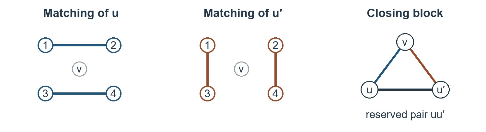

# A proof of the Colbourn–Dinitz–Rosa conjecture

**Juan Pablo Traverso Gianini**  
Independent researcher, Santiago, Chile  
[jtraverso@gmail.com](mailto:jtraverso@gmail.com)  
[ORCID: 0009-0003-6068-4096](https://orcid.org/0009-0003-6068-4096)

**Paper II. Bicolorings of Steiner triple systems.**  
**Preprint 1.0 — 6 November 2026.**

## Abstract

In 1999 Colbourn, Dinitz and Rosa constructed all admissible profiles of order below 1000 and conjectured that every admissible profile occurs [1]. We prove their conjecture. Three prescribed positive class sizes occur in a strictly 3-bicolored Steiner triple system exactly when they satisfy the order congruence, the pair-count identity and the exclusion of two classes of size two. Our proof combines the product of Colbourn, Dinitz and Rosa with constructions by edge coloring. The regular remainder uses Chetwynd–Hilton; the narrow families use Plantholt, Cao–Chen–Jing–Shan, and vertex-distinguishing colorings. An exhaustive arithmetic check reduces the finite base to 49 profiles of order at most 487. Their existence already follows from Theorem 2.6 of [1].

## 1. The class-size problem

A Steiner triple system is a set of points together with triples, called blocks, such that each unordered pair belongs to exactly one block. A strict 3-bicoloring partitions the points into three nonempty classes; a block has two points of one color and one of another. The system itself may be chosen to fit the partition. Colbourn, Dinitz and Rosa constructed the admissible profiles of order less than 1000 and asked whether *each* admissible profile occurs at every order (Theorem 2.6 and Conjecture 2.7 of [1]). Their Theorem 2.8 also gives at least one bicoloring for a family of orders described by their prime factors. The conjecture asks for every admissible choice of sizes at the given order. In 2002 Dinitz and Stinson gave a singular direct product construction and restated the open problem as Conjecture 1.4 [2]. Dummit studied the arithmetic restrictions on possible profiles [3]. Later work extended bicolorings through a doubling construction [4]. We have found no earlier proof covering every admissible three-class profile. Theorem 1 gives such a construction.

**Theorem 1.** Let $a,b,c$ be positive integers and let $n=a+b+c$. There exists a strictly 3-bicolored Steiner triple system with class sizes $a,b,c$ if and only if
$$n\equiv1,3\pmod6,\qquad a^2+b^2+c^2-ab-ac-bc=n,$$
and no two of $a,b,c$ are both equal to 2. We call such a profile admissible.

**Case map.** Sort $a\le b\le c$, set $x=b-a$, $y=c-b$, and use strong induction on $n$. The branches below are taken in order.

| Condition | Construction |
|---|---|
| $n<5059$ | Finite grid and CDR [1, Thm. 2.6], §5. |
| $c$ even, $x=1$ | Cyclic coloring, Lemma 5.2. |
| $c$ even, $x\ne1$ | Equitable coloring with roles $(a,b,c)$, Lemma 5.1. |
| $c$ odd, $x\ge6$ | Equitable coloring with roles $(a,c,b)$, Lemma 5.1. |
| $c$ odd, $x=4$ | Distinct missing pairs, Lemma 5.3. |
| $c$ odd, $x=0,2$ | Composite descent or prime gap two, Lemma 5.4. |

**Necessity.** Each block through a fixed point accounts for two of its $n-1$ neighbors, so $n$ is odd. Counting all pairs gives $n(n-1)/6$ blocks, an integer. Together these give the two residues modulo six. Every block accounts for exactly one same-color pair. Hence
$$\binom a2+\binom b2+\binom c2=n(n-1)/6.$$
Multiplication by six and substitution of $n=a+b+c$ gives the quadratic identity in the theorem.

Suppose $A$ and $B$ each have two points. Their four cross pairs can be covered only by $AAB$ and $ABB$ blocks. Each type occurs at most once, since the repeated class has only one internal pair. We therefore need one of each. The chosen $B$ point of the first block and the chosen $A$ point of the second would occur together twice. This rules out the profile. In the positive solutions of the quadratic identity this exception is $(2,2,5)$ up to permutation: setting $a=b=2$ gives $c^2-5c=0$.

## 2. Gaps and the product

Sort the sizes as $a\le b\le c$. Write $x=b-a$, $y=c-b$. Twice the quadratic expression in Theorem 1 is the sum of the three squared differences. Substituting $x,y,x+y$ therefore gives
$$n=x^2+xy+y^2,\qquad 3a=n-2x-y,\quad b=a+x,\quad c=b+y.$$
For example, $x=2,y=3$ gives $n=19$ and $(4,6,9)$. Knowing an order is represented by the quadratic form is one question; constructing a system for each resulting positive profile is another.

The form is the norm of $x-y\omega$, where $\omega^2+\omega+1=0$. If a prime $p\equiv5\pmod6$ divides the norm, then it divides both $x$ and $y$. Indeed, if $y$ were invertible modulo $p$, $x/y$ would solve $z^2+z+1=0$, giving a nontrivial cube root of unity in a group of order $p-1\equiv1\pmod3$. If $p\mid y$ the equation gives $p\mid x$ directly. Dividing both by $p$ removes $p^2$ from the norm. Repetition proves the familiar even-exponent condition. Dummit [3] studies which class sizes the arithmetic permits at prime and prime-square orders. The product below addresses realization once the sizes are known.

**The product step [1].** Suppose an inner system has classes of sizes $(a,b,c)$, each of size at most half its order, and an outer system has sizes $(u,v,w)$. Put a copy of the inner system above each outer point. Subtract the outer color from the inner color modulo three. The resulting class sizes, obtained by grouping points of the same difference, are
$$(ua+vb+wc,\;ub+vc+wa,\;uc+va+wb).$$
Pairs within a copy already have a block. For each outer block use a Latin square on the three copies above its points: a point in either of two copies determines a unique third entry once its partner is fixed. This covers every cross pair once because its outer pair lies in a unique outer block. The forbidden Latin square lemma of [1] uses the balance of the inner sizes to avoid triples whose color sum is zero modulo three. Three residues have zero sum exactly when all three agree or all three differ. Thus each transversal block has two colors.

**Lemma 2.1 (composite descent).** Let $n>49$ be composite and let $(a,b,c)$ be admissible of order $n$. Up to permutation, either $n=p^2$ for a prime $p\equiv2\pmod3$ and $(a,b,c)=E(p)$, or the profile is the CDR product of an admissible inner profile of order $m_1$, all of whose classes have size at most $m_1/2$, and an outer profile of order $m_2=n/m_1$, with $1<m_1,m_2<n$. The outer profile is admissible, or $m_2=3$ and it is the auxiliary triple $(0,1,2)$. Here
$$E(p)=\bigl(p(p-2)/3,\ p(p+1)/3,\ p(p+1)/3\bigr).$$
Consequently, realizations at smaller admissible orders, together with the profiles $E(p)$, imply realization at order $n$.

*Proof.* In Eisenstein coordinates the CDR product multiplies the encodings, up to permutation of classes. There are four factor choices, taken in the following order. If $3\mid n$, we first take the factor of norm three on the outside, so $m_2=3$ and not 9. In all subsequent cases $3\nmid n$, so the outer order is not 9 either; consequently it cannot decode to the excluded profile $(2,2,5)$. A factor 3 supplies the outer triple $(0,1,2)$, whose one block still uses two colors. An inert prime supplies the balanced inner profile $E(p)$; if its cofactor is a unit this is the square exception in the statement. A split prime $p\ge13$ supplies an inner factor of norm $p$. If only powers of 7 remain, $n>49$ allows an inner factor of norm 49. The following extraction and decoding arguments justify these choices. The largest class of $E(p)$ is even, so the even-class branch or the finite base supplies that profile without assuming the result at order $n$.

It remains to justify extracting a factor of norm $p$ when $p\equiv1\bmod3$. Work in the Eisenstein integers. Choose a nontrivial cube root of unity $r$ modulo $p$. Evaluating the encoding and its conjugate at $r$ gives a product zero modulo $p$, so at one of $r,r^2$ the encoding vanishes. Use that root. Among $(i,j)$ with $0\le i,j\le\lfloor\sqrt p\rfloor$ two give the same value of $i+jr$. Their nonzero difference $(u,v)$ has norm divisible by $p$ and strictly below $3p$, since $|u|,|v|\le\lfloor\sqrt p\rfloor$. The norm cannot be $2p$: checking the two coordinates modulo two shows that even norm forces both coordinates even and thus norm divisible by four. We have found an element $\pi$ of norm $p$ vanishing at our root. The kernel of evaluation has index $p$ (integer constants give all residues); the ideal generated by $\pi$ also has index $p$ because multiplication has determinant equal to the norm. The inclusion of the ideal in the kernel is therefore equality, so $\pi$ divides the encoding. For the factor three, reduction at $\omega=1$ has kernel $(1-\omega)$ of index three, and $(u+v)^2\equiv0\bmod3$ gives divisibility. These arguments justify the two extractions used with the decoding formula.

Here is the arithmetic behind the choice of factors. Use the encoding $(u,v)=(a-c,b-c)$, with norm $m=u^2-uv+v^2$. Decoding gives $(d+u,d+v,d)$ with $d=(m-u-v)/3$. Write $R(u,v)=u+v\bmod 3$. This residue is multiplicative, invariant under conjugation and satisfies $R^2=m\bmod3$. Change the signs of both factors together so the inner one has $R=m_1\bmod3$; conjugate the outer one for the product formula. If $m_1=1\bmod3$, multiplication determines the required outer residue. If $3\mid m_2$, its residue is already zero. Hence both triples are integral. Each coordinate is $(m-X)/3$ for one of $X=u+v,v-2u,u-2v$, and completing the square gives $X^2\le4m$. For $m\ge7$ this gives positivity. For $m\ge16$ it also gives $-2X\le m$, so each inner class has size at most $m/2$. For $13\le m<16$ a violation would require $m=13$ and $X=-7$, contrary to $X\equiv m\bmod3$. For the factor of norm three we put the triple $(0,1,2)$ outside: the single outer block still meets two colors, which is all that the Latin-square construction uses. When seven is the only prime divisor, remove two norm-seven factors. Their product has norm 49, hence gives a balanced inner triple; the remaining norm is at least seven. These are the sign and balance checks used in descent_composite.

## 3. Constructing five block types in succession

We describe the main construction with class sizes $A,B,C$, now denoting the *roles* in the construction; they may be a permutation of the sorted sizes. Arrange that $C$ is even and build a system with no $AAC$ block. The following sufficient hypotheses record where this construction works. Set $E=A(A-1)/2$ and $h=A-2\lfloor E/B\rfloor$. In addition to admissibility assume
$$
\begin{gathered}
 C\equiv0\pmod2,\quad A<C,\quad A<B,\quad B-A\text{ odd},\quad B-A\ge3,\\
 6(C-A-1)\le C,\quad 6C\le7A,\quad 6h\le B,\quad B+5\le h+C .
\end{gathered}
$$
At an $A$ point the first coloring covers $A-1$ of its $B$ cross pairs, so the number still missing is $B-A+1$. Its evenness allows pairing. The limits $6h\le B$ and $B+5\le h+C$ control the two extremes of the missing multiplicities in the row constructions. The bound $6(C-A-1)\le C$ gives slack for the second row completion; $6C\le7A$ is used only on the last regular graph.

The row completion lemmas use the slack in these inequalities to choose edge-disjoint matchings on prescribed missing sets. A row is the set of cross pairs incident to one fixed point. The table follows a row through the construction.

**Lemma 3.1 (pairing missing labels).** In a proper coloring, let the multiplicity of a label be the number of rows missing it. Suppose each row misses an even number of at least four labels, each multiplicity is $m$ or $m+2$, and there are at least $6(m+2)$ labels. After recoloring, the missing sets admit perfect matchings, disjoint as sets of pairs across all rows. The number of labels of each multiplicity is preserved (l181_noAnchor).

**Lemma 3.2 (completing partly paired rows).** Suppose the rows of a proper coloring have even missing sets. Some are already perfectly paired, with no repeated pair; the others start empty and miss at least four labels. If every multiplicity is at most $\rho$ and at least $6\rho$ labels have multiplicity $\rho$, a recoloring admits disjoint perfect pairings for every row and preserves each label's multiplicity (l156). In Lemma 5.3 we first pair the two-label rows; their missing pairs are distinct. The four-label rows are the open rows in this lemma, with $\rho=C-A-1=3$. Distinguishing the rows alone would not choose two compatible pairs for each of them.

Both proofs complete one row at a time. Choose a largest tentative matching compatible with the other rows. If it leaves uncovered labels, the switching step recolors alternating components and replaces the tentative matching by a larger one while maintaining disjointness and completeness of the rows already closed. In the second lemma the auxiliary label must have multiplicity $\rho$; the supply of $6\rho$ such labels gives the room bound used in stepQ. Each successful switch increases the number of pairs, bounded by half the row size. Once the row closes, the number of open rows decreases. Section 6 proves the switch and counts the excluded labels.

| Blocks added | Choice | Pairs accounted for |
|:--|:--|:--|
| $AAB$ | Color the edges within $A$ properly and equitably by points of $B$. | Every $AA$ pair and two $AB$ pairs per edge. |
| $ABB$ | For each point of $A$, pair the points of $B$ still missing from its row. | All remaining $AB$ pairs and one $BB$ pair per block. |
| $BBC$ | Color the unused $BB$ edges by points of $C$. | The remaining $BB$ pairs and part of $BC$. |
| $BCC$ | For each point of $B$, pair the missing $C$ points by disjoint edge choices. | All remaining $BC$ pairs and some $CC$ pairs. |
| $ACC$ | Partition the unused $CC$ edges into perfect matchings indexed by $A$. | The remaining $CC$ pairs and every $AC$ pair. |

We use Vizing's edge coloring theorem and equitable rebalancing [5,6]. In a proper edge coloring two edges meeting at a vertex have different colors. Each color therefore gives a matching, so two edges with the same singleton cannot reuse a cross pair. An equitable coloring has color-class sizes differing by at most one. After the first step, a color used on $j$ edges at the $AAB$ stage has $A-2j$ missing incidences in $A$. The two possible values differ by two. The first row-completion lemma deals with exactly these multiplicities; choosing the row matchings disjoint prevents the same $BB$ pair from being spent twice.

At the third step the residual $BB$ edges number $C(A+B+1-C)/2$. Indeed, $AAB$ covers $2E$ cross pairs and $ABB$ therefore uses $(AB-2E)/2$ internal $BB$ pairs. Subtracting this from $\binom B2$ and using the quadratic identity gives the stated number. Here $A+B+1-C$ is even. Equitable coloring therefore puts exactly $(A+B+1-C)/2$ edges in every color. A point of $C$ then misses $B-(A+B+1-C)=C-A-1$ points of $B$. The second row-completion lemma gives the $BCC$ blocks. Each such missing incidence consumes one $CC$ edge at that point, leaving degree $(C-1)-(C-A-1)=A$.

The remaining graph is regular of degree $A$ on $C$ points. We use the even-order factorization result: a simple regular graph on $N$ even points and of degree $d\ge6N/7$ has a 1-factorization [7]. The inequality $6C\le7A$ is exactly this hypothesis. Each of the resulting $A$ perfect matchings receives its own point of $A$ as singleton. Every $C$ point occurs once in that matching, so every required $AC$ pair is covered. Reading the last column of the table now proves the asserted realization.

**Following the construction at order 331.** Take $(A,B,C)=(100,121,110)$ in the roles of the table. Here $E=4950$, $\lfloor E/B\rfloor=40$ and $h=20$. The first step uses colors on 40 or 41 edges, leaving 20 or 18 missing incidences per color. There are $100\cdot121-2\cdot4950=2200$ cross pairs still to cover, so the second step uses 1100 internal pairs of $B$. Of its $\binom{121}{2}=7260$ pairs, 6160 remain. Split among the 110 points of $C$, these give 56 edges per color. Each point of $C$ now misses $121-2\cdot56=9$ points of $B$. Pairing the missing incidences spends nine edges at each point of $C$ and leaves degree $109-9=100$. The final graph has 110 vertices and $6\cdot110\le7\cdot100$. Its 100 perfect matchings take one point of $A$ apiece. This is why the factorization is needed only after the other rows have been completed.

## 4. The narrow family and the last missing pair

For a prime order at least 5059 with $c$ odd and $b=a+2$, substitute $x=2$ into the gap equations of Section 2. They give $3a=y(y+1)$ and $n=y^2+2y+4$. Here $a,b$ are even and $y$ odd. If $3\mid y+1$, then $3\mid n$, which is impossible for this prime. Hence $y=6k+3$, and substitution gives
$$a=12k^2+14k+4,\quad b=a+2,\quad c=12k^2+20k+9.$$
The construction in fact works for every $k\ge4$, including composite orders in this family. At $k=4$ it gives $(252,254,281)$, of order 787.

**Lemma 4.1 (the preliminary packing).** Reserve one perfect matching on $A$. A preliminary packing of types $AAB,ABB,BBC,BCC$ leaves exactly the reserved $AA$ matching, all $AC$ pairs, and a graph $F$ of unused $CC$ pairs. The packing lemma chooses a point $w$ and a set of $3k+1$ other points in $C$ so that their degrees in $F$ are respectively $6k+2$ at $w$, $a-2$ on the set, and $a$ elsewhere.

The degree calculation has a direct interpretation. After reserving the matching, stage A colors the remaining $AA$ edges and pairs the missing $B$ labels in each row. Stage B colors the remaining $BB$ edges equitably with $c-1$ labels, leaving $w$ unused. Its missing multiplicity is therefore $b$. For every other label the multiplicity is $b$ minus twice the size of its color class. The class sizes differ by one; dividing the edge total gives $3k+1$ smaller classes. Their missing multiplicities are $6k+6$, against $6k+4$ for the others. The anchored row lemma pairs the missing labels in stage B, reserving distinct partners for $w$. Every missing incidence spends one edge at that label in $K_C$. Subtracting the three multiplicities from $c-1$ gives precisely the degrees at $w$, on the distinguished set and elsewhere. The matching and recoloring steps are stageA and stageB in the shared archive.

These numbers matter because the edge-coloring lemma for this degree pattern gives a proper coloring with $a$ colors. Deleting $w$ gives $\delta\ge a-3$ and $\Delta\le a$, so $7(3\delta-\Delta)\ge14a-63$. Thus $12(c-1)\le14a-63$ suffices for the Plantholt inequality. Substituting the displayed values of $a,c$ gives $14a-12(c-1)-63=24k^2-44k-103$. Its two numerical tests come from the critical-graph bound [8] and the dense overfull criterion [9,7]. With $6/7$ they reduce respectively to
$$12k^2-46k-8\ge0,\qquad 24k^2-44k-103\ge0.$$
At $k=4$ their values are 0 and 105. Both increase thereafter. The remaining packing hypotheses already hold at this cutoff. This is the base of the family: increasing $k$ by one increases the left sides by $24k-34$ and $48k-20$.

1. Delete $w$ and write $N=c-1$. If the remaining maximum degree is below $a$, Vizing gives the required $a$ colors. Otherwise $\Delta=a$ and $\delta\ge a-3$. The even-order criterion used here says that if $12N\le7(3\delta-\Delta)$, a graph needs more than $\Delta$ colors exactly when it has an odd set with more than $\Delta(|S|-1)/2$ edges. The inequality follows from $14a-63-12(c-1)=24k^2-44k-103\ge0$. To see why an overfull set must omit one vertex, let $S$ be odd and put $t=N-|S|$. A set with $|S|\le a$ is not overfull by comparison with the complete graph. Otherwise, if $t\ge3$, then $3\le t\le N-a-1=6k+3$ and
$$2e(S)\le a|S|-e(S,\overline S),\qquad e(S,\overline S)\ge t(\delta-t+1)\ge t(a-t-2).$$
   Overfullness would force the cut to be smaller than $a$. The last quadratic is concave in $t$. At the endpoints its values are $3(a-5)\ge a$ and $(6k+3)(a-6k-5)\ge a$ for $k\ge4$, a contradiction. Only $t=1$ remains. Put $H=F-w$. The degree pattern of Lemma 4.1 gives $2e(H)=aN-12k-4$. For every $z\in V(H)$,
   $$2e(H-z)=aN-12k-4-2d_H(z)\le a(N-2)-12k+2\le a(N-2),$$
   since $d_H(z)\ge a-3$. Thus these sets are not overfull either.
2. Return to $F$. Odd sets avoiding $w$ satisfy the edge bound by the coloring just obtained. Sets of size at most $a$ satisfy it by comparison with a clique. For larger sets containing $w$, the residual degree count gives the same bound by counting the deficit on the complement.
3. If $F$ required more than $a$ colors, take a critical subgraph on its support. It contains $w$, has maximum degree $a$ by Vizing, and minimum degree at most $6k+2$. Its order $N'$ lies between $a+1$ and $c$.
4. CCJS [8, Thm. 1.2] gives overfullness for a critical graph when $3N'+7\delta'\le4\Delta'+17$ and $N'+\delta'\ge27$. The second condition follows from $a\ge252$. For the first, $4a+17-3c-7(6k+2)=12k^2-46k-8\ge0$.
5. The vertices of an overfull subgraph would be one of the odd sets excluded in step 2. This contradiction gives a proper coloring of $F$ with $a$ colors.

Why does a proper edge coloring suffice? Relative to degree $a$, the sum of the deficits is
$$[a-(6k+2)]+2(3k+1)=a.$$
Consequently $2|E(F)|=ac-a=a(c-1)$. Since $c$ is odd, each of the $a$ color classes is a matching of size at most $(c-1)/2$. The sum achieves the upper bound, so every color misses exactly one point of $C$. At a given point $v$, precisely $a-\deg_F(v)$ colors miss $v$, an even number at every vertex. Pair these colors within each such set, and biject their pairs with the reserved matching on $A$.

Label a matching by its assigned point $u$ of $A$ and attach $u$ to its edges to obtain $ACC$ blocks. If the matchings assigned to $u,u'$ both miss $v$, add the block $\{u,u',v\}$. This one block covers the reserved pair $uu'$ and the two remaining cross pairs $uv,u'v$. Each reserved pair is used once and each missing cross pair has a unique such block. Figure 1 shows the last step for two matchings. The same pairing works when more colors miss that point.

## 5. Why the cases cover every order

**Lemma 5.1 (equitable branches).** At $n\ge5059$ the criterion of §3 applies in the indicated roles if $c$ is even and $x\ne1$, or if $c$ is odd and $x\ge6$.

*Proof.* Put $s=x+y$. As $n\le s^2$ and $71^2<5059$, we have $s\ge72$. From $n=s^2-xy\ge3s^2/4$ and $3a=n-2x-y$ we obtain $a\ge s^2/4-2s/3\ge17s$. Write $A=a$, $B=a+t$, $C=a+u$. In the first case $(t,u)=(x,s)$; in the second $(t,u)=(s,x)$. Since $n$ is odd, one or three classes are odd; the quadratic identity excludes three by parity. Thus $C$ is even and $t$ odd. In both cases $t\ge3$, $u>0$, and $a\ge17s$ gives $6(u-1)\le C$ and $6C\le7a$.

It remains to check the two inequalities involving $h$. Long division gives
$$\frac{a(a-1)}{a+t}=a-t-1+\frac{t(t+1)}{a+t}.$$
The remainder fraction is increasing in $t\ge0$ and at $s$ is less than four, since $a+s\ge s^2/4+s/3$. With $h=a-2\lfloor a(a-1)/(2B)\rfloor$ this gives $t-3<h<t+3$. Hence $6h\le B$. For the last inequality we need $h\ge t+5-u$. If $u\ge8$ it follows at once. The only remaining case is $u=x=6$, where $a$ is even, $h$ is even and $t$ odd; hence $h>t-3$ implies $h\ge t-1$. This covers $y=0,1$ as well as $y\ge2$ in the even-largest-class branch. The corresponding formal branches are master_y0, master_y1, master_l157 and branchL161_of.

**Lemma 5.2 (cyclic branch).** An admissible profile with $B=A+1$, $C$ even, $4\le A$, $A+4\le C$, $6(C-A-1)\le C$ and $6C\le7A$ is realizable (x1_realises). In sorted order write $A=a$ and $C=a+1+y$. Since $3a=y^2-1$, the two degree bounds reduce to $y^2-15y+2\ge0$ and $(y-19)(y+1)\ge0$. For positive integer $y$ these hold from 15 and 19 respectively. Thus $y\ge19$ suffices regardless of order. In the large-order branch this is automatic because $n=1+y+y^2$; the finite branch checks the degree bounds directly. Each point of $A$ misses exactly two labels among $B=a+1$. When $a$ is odd label the points modulo $a$, use color $i+j$ on $ij$, and add a spare color. Point $i$ misses $2i$ and the spare; these pairs are distinct. When $a$ is even use the round robin on the residues modulo $a+1$ and infinity, coloring $ij$ by $i+j$ and the edge from infinity to $i$ by $2i$. Delete vertices 0 and 1. The missing pairs are $\{i,i+1\}$ at remaining residues and $\{0,2\}$ at infinity. They are distinct. Use each missing pair as one $ABB$ block. The hypotheses now give the remaining row completion and the final factorization as in Section 3.

**Lemma 5.3 (gap four).** For $c$ odd and $x=4$ and $y\ge17$, use $A=a$, $C=a+4$, $B=C+y$. Here $3a=y^2+3y+8$ and $y$ is odd. This range includes finite cases: $y=17$ gives order 373. For $n\ge5059$ it is automatic, since $y\le16$ would give $n=16+4y+y^2\le336$. Put $k=(y^2-1)/6$. The first equitable coloring uses each label on $k$ or $k+1$ edges; indeed the number $r$ of smaller classes is $B(k+1)-\binom a2=(y^2-3y+20)/6$, strictly between zero and $B$. The missing multiplicities are $a-2k=y+3$ and $y+1$. The first row lemma applies: $6(y+3)\le B$ by the displayed formula for $a$. The unused graph on $B$ has $r$ vertices of degree $C-4$ and $B-r$ of degree $C-2$.

BKLS [10, Cor. 12] gives a vertex-distinguishing proper coloring with at most $k_0+1$ colors if the minimum degree is at least 5 and $(\Delta-4)^2\ge2B$, where $k_0$ is the least palette size satisfying $\binom{k_0}{d}\ge n_d$ for every degree multiplicity $n_d$. Here $\Delta=C-2$, and $C-4=a\ge116$, $B=C+y$, so the degree bounds follow directly from $3a=y^2+3y+8$. At palette size $C-1$ the capacities for the two degrees are $\binom{C-1}3$ and $C-1$. Both multiplicities are at most $C-1$ by the formula for $r$; since $B-r>1$, size $C-2$ is insufficient. Hence $k_0=C-1$. Rudašová–Soták [11, Thm. 3.1] gives an equitable distinguishing coloring with $C$ colors. Distinct incident-color sets give distinct complements; rows missing two labels can therefore spend those pairs without conflict. The row completion and final factorization of §3 apply ($C-A-1=3$, $6C\le7A$). This is x4_core. The precise point of the Rudašová–Soták theorem is that requiring equitability leaves the minimum number of distinguishing colors unchanged.

**Lemma 5.4 (last two gaps).** If $c$ is odd and the preceding branches fail, $a,b$ are even, hence $x=0$ or 2. For composite $n$ the descent in §2 applies by strong induction; its extra square profiles have even largest class and are available by Lemma 5.1 or the finite base. At prime order $x=0$ would give $n=y^2$. For $x=2$, §4 gives $y=6k+3$. If $k<4$, then $n=y^2+2y+4\le487$. Hence §4 supplies the required realization. This proves the induction step. The cutoff 5059 is a sufficient common cutoff: it forces $s\ge72$ and puts the cyclic, gap-four and gap-two cases above their own thresholds. We use no optimality of this number.

It remains to justify the base of the induction. For $n<5059$, the norm formula gives $0\le x,y<72$ since $72^2>5059$. Run through this square of integer pairs. Compute $n=x^2+xy+y^2$ and recover $a=(n-2x-y)/3$. Retain only integral, positive, admissible profiles of the specified order. Each sorted profile occurs exactly once, since it determines its gaps. There are 1,551 such profiles. The construction tests can be used at their actual thresholds inside this square; for composite orders above 49 the same descent works by induction within the base. After the construction and descent cases, 49 profiles, all of order at most 487, remain for the published small-order theorem.

By Theorem 2.6 of Colbourn–Dinitz–Rosa [1], each of these 49 profiles is realized. Their theorem covers orders below 1000 satisfying the prime-factor condition in their Theorem 2.2 and the split identity; the paragraph preceding it imposes the duplicity restriction. Our profiles meet the prime-factor condition by §2 and exclude the two classes of size two. Thus the cited theorem supplies the last cases of the written proof. The independent multiplication tables are discussed in the appendix. CDR describe a search using Stinson’s hill-climbing algorithm. Their article does not print the individual systems. Our archive supplies reproducible tables for all 49. The five cyclic orders in the grid are 1483, 1723, 2551, 3541 and 3907; Lemma 5.2 applies to each. The split into five cyclic cases and 49 tables reflects the grid rule: it sends (133,134,154) to a table because its order 421 is below 508, although Lemma 5.2 also applies.

The following count makes the finite step reproducible. Read the rows from top to bottom and assign a profile to the first applicable construction. A profile is counted only once even if two constructions work.

| First applicable step for $n<5059$ | Profiles |
|:--|--:|
| Composite descent (special square profiles tested separately) | 1201 |
| Equitable construction in one of the six class orders | 287 |
| Cyclic first stage | 5 |
| Gap four | 5 |
| Gap two | 4 |
| CDR [1, Thm. 2.6] | 49 |
| **Total** | **1551** |

The supplementary table [S1] lists all 1,551 profiles and the construction used for each.

The sum in the last line accounts for every admissible gap pair in the finite range. The last row is contained in the range of [1, Theorem 2.6], and every other row invokes a construction or a smaller order. Strong induction now proves Theorem 1. The cutoff 5059 separates the finite grid from the uniform construction for existence. Paper I asks for a prescribed block count and obtains an existential threshold for that different conclusion.

## 6. The switches used to complete the rows

Lemma 3.1 is the unanchored case with $\rho=m+2$; Lemma 3.2 is the fixed-multiplicity case. The anchored variant used in Section 4 reserves the specified partner while making the same switches.

**How to exchange a missing and a present label.** In a row that misses $p$, suppose $p$ has not yet been paired and $x$ is present. Interchanging $p,x$ on a single edge could break properness elsewhere. To find the rows that must change together, draw two marks per row, one for each of $p,x$, and join the two marks. Join like marks across each edge colored with their label. Finally link unlike marks if two different rows already use pairs $pz$ and $xz$ with the same partner $z$. Each mark has its internal link and at most one further link: an incident color occurs only once, a missing color has at most one partner, and the pair with that partner occurs in at most one other row. The components are paths or cycles. Interchange the two colors throughout an entire component, including in its row pairs. Closure along like marks preserves properness; closure along unlike marks prevents any two row pairs from becoming equal. A closed row remains perfectly paired.

An endpoint is a missing mark with no external link. In each component the number of missing $p$ marks minus missing $x$ marks equals the difference of endpoint counts of those two kinds: each link between missing marks accounts for one of each. The component containing the unpaired $p$ in the chosen row is a path. Its endpoint difference is zero or two. In the latter case, if the multiplicity of $x$ is at least that of $p$, the total endpoint difference is nonpositive, so there is a second component with two $x$ endpoints. Flip both. Otherwise the two multiplicities are the low and high values of Lemma 3.1, and flipping the first component alone exchanges their levels. This proves the multiplicity claims. In Lemma 3.2 choose $x$ of maximum multiplicity so that the first alternative always applies. Only one free $p$ endpoint other than that of the chosen row can have been flipped; the compensating component has none. Thus at most one previously unused pair of $x$ with a protected partner can become used. Pairs involving neither $p$ nor $x$ keep their status.

**Why there is room and why the process ends.** Let $S$ be the unpaired support in the open row. Choose a largest matching $T$ on $S$ using pairs not previously used anywhere. Suppose $d_0\ge2$ points are exposed and write $\rho$ for the maximum label multiplicity. Each exposed point has at most $\rho-1$ used neighbors because this row still misses it. Every pair of exposed points is used, or $T$ could be enlarged. For each $ab\in T$ there are at least $d_0$ used incidences from exposed points to $a,b$: otherwise two distinct exposed points could replace $ab$ by two free pairs (if both have access only to the same endpoint, the other endpoint already contributes $d_0$ used incidences). Counting at the exposed points gives $d_0(d_0-1)+d_0|T|\le d_0(\rho-1)$. Hence $d_0+|T|\le\rho$ and $|S|=d_0+2|T|\le2\rho-2$.

In the unanchored case the pool contains at least $6\rho$ labels. Exclude the row support and all used neighbors of at most four specified unpaired or tentatively paired labels. This discards at most $|S|+4(\rho-1)<6\rho$ choices. In the fixed-quota case use just the pool of labels of multiplicity $\rho$. If an anchor pair is prescribed in this row, exclude its two ends as well; the bound is still strict. Exchanges carry along the existing row pairs and avoid the frozen anchor color. In particular, the pairs through the common missing label remain disjoint.

If $T$ is empty, the open support has at least four points. Choose exposed $p,u,v$ and a clean label $x$ for them; move the missing label $p$ to $x$ as just described. At most one of $xu,xv$ became used, so insert the other. If $T$ is nonempty take $ab\in T$ and exposed $p,u$. Choose $x$ clean for $p,u,a,b$ and move $p$ to $x$. If $xu$ is free, insert it. If it was lost, $xa$ and $xb$ are free. Now choose $z$ clean for $u,x,a,b$ and move $u$ to $z$. If $xz$ is free, insert it; otherwise both $za,zb$ are free, and $xa$ remains free because the second exchange did not touch either of its labels. Replace $ab$ by $xa,zb$. In every case the number of tentative pairs increases. It cannot exceed half the row size. Close the completed row and repeat on the remaining rows. This proves the row-completion steps of §3 and the anchored version used in §4.

**The anchor and the odd-set count in §4.** Let $K_0=6k^2+4k+1$. In stage A, deleting a perfect matching from $K_A$ leaves degree $a-2$; equitable coloring with $a+2$ colors gives four missing colors per row and multiplicities two or four. In the remaining graph on $B$, four vertices have degree $a-1$ and the rest $a-3$. With $c-1$ colors its edge count is $(c-1)K_0-(3k+1)$; hence precisely $3k+1$ color classes have size $K_0-1$. To pair the omitted color $w$ in each row, take as potential partners all other missing colors. Each row has at least $6k+5$ of these, and at most $6k+6$ rows miss any one color. Four rows have $6k+5$ available partners; all others have $6k+7$. For any nonempty set of $h\le7$ rows, one row alone has at least $h$ partners since $k\ge4$. For $h\ge8$ there are at least $(6k+7)h-8\ge(6k+6)h$ incidences, while any one partner occurs at most $6k+6$ times. The union contains at least $h$ partners. Hall's theorem assigns distinct representatives. Freeze the resulting pairs through $w$ and apply the anchored switch above.

Write $s=6k+2$ for the degree at $w$. The total degree of $F$ is $a(c-1)$: the deficit at $w$ is $a-s$ and the $s/2$ exceptional points contribute another $s$. For $H=F-w$ and $x\in H$,
$$2e(H-x)\le a(c-1)-2s-2(a-3)\le a(c-3).$$
Here $s\ge3$. For any odd set $S$ containing $w$ with $|S|>a$, put $t=|V(F)\setminus S|$. Since $c+2\le2a$ we have $t+3\le a$. The complement omits $w$, hence its vertices each have degree at least $a-2$. Subtract twice their degree sum from $2e(F)$ and add back twice their internal edges, at most $t(t-1)$. This gives
$$2e(S)-a(|S|-1)\le t(t+3-a)\le0.$$
These are the two odd-set estimates needed before the application of CCJS.

## Appendix. The formal characterization

The following are the statement headers in namespace CDRBicolour. Unlike the citation-based base case above, the frozen proof verifies the 49 explicit tables. Its axiom report records one compiler-dependent native reduction per table in addition to the three standard axioms. The independent Python check corroborates the data; the Lean trust boundary still includes the compiler and compiled evaluation. The technical report [S2] lists the exact audit results. The companion spectrum article [12] uses the absorption theorem of [13] for a different prescription.

~~~
theorem cdr_conjecture : CDRConjecture

theorem cdr_characterization {a b c : ℕ} (ha : 0 < a) (hb : 0 < b) (hc : 0 < c) :
    Realises a b c ↔ AdmissibleProfile a b c

theorem cdr_characterization_bicolourable3 {a b c : ℕ} (ha : 0 < a) (hb : 0 < b) (hc : 0 < c) :
    CDR.Bicolourable3 (a + b + c) a b c ↔ AdmissibleProfile a b c
~~~

## Acknowledgments

The author is deeply grateful to his wife María Paz and his children Lucas, Juan Cristóbal, Francisca, Raimundo and Benjamín for their love, patience and support.

## Use of artificial intelligence and computational tools

Claude, by Anthropic, and ChatGPT/Codex, by OpenAI, were used to explore and check arguments and to prepare the manuscript.

Certo [14] and Jacobian [15] were used to explore finite instances, check identities and assess candidate constructions. These computations informed the development of the arguments; finite checks were not treated as proofs of universal statements.

The author remains responsible for the arguments, citations, code and presentation. No AI system is listed as an author.

## References

1. C. J. Colbourn, J. H. Dinitz and A. Rosa. Bicoloring Steiner triple systems. *Electronic Journal of Combinatorics* 6 (1999), R25. <https://doi.org/10.37236/1457>.
2. J. H. Dinitz and D. R. Stinson. A singular direct product for bicolorable Steiner triple systems. In *Codes and Designs* (2002), 87–98. <https://cs.uwaterloo.ca/~dstinson/papers/bicoloring.pdf>.
3. D. S. Dummit. CM elliptic curves and bicolorings of Steiner triple systems. *Bulletin of the London Mathematical Society* 34 (2002), 403–410. <https://doi.org/10.1112/S0024609301008785>.
4. M. Gionfriddo, E. Guardo and L. Milazzo. Extending bicolorings for Steiner triple systems. *Applicable Analysis and Discrete Mathematics* 7 (2013), 225–234. <https://doi.org/10.2298/AADM130827019G>.
5. V. G. Vizing. On an estimate of the chromatic class of a p-graph. *Diskretnyi Analiz* 3 (1964), 25–30.
6. C. J. H. McDiarmid. The solution of a timetabling problem. *Journal of the Institute of Mathematics and Its Applications* 9 (1972), 23–34. <https://doi.org/10.1093/imamat/9.1.23>.
7. A. G. Chetwynd and A. J. W. Hilton. Regular graphs of high degree are 1-factorizable. *Proceedings of the London Mathematical Society* (3) 50 (1985), 193–206. <https://doi.org/10.1112/plms/s3-50.2.193>.
8. Y. Cao, G. Chen, G. Jing and S. Shan. The overfullness of graphs with small minimum degree and large maximum degree. *SIAM Journal on Discrete Mathematics* 36 (2022), 2258–2270. <https://doi.org/10.1137/21M1432776>.
9. M. Plantholt. Overfull conjecture for graphs with high minimum degree. *Journal of Graph Theory* 47 (2004), 73–80. <https://doi.org/10.1002/jgt.20013>.
10. P. N. Balister, A. Kostochka, H. Li and R. H. Schelp. Balanced edge colorings. *Journal of Combinatorial Theory B* 90 (2004), 3–20. <https://doi.org/10.1016/S0095-8956(03)00073-X>.
11. J. Rudašová and R. Soták. Vertex-distinguishing proper edge colourings of some regular graphs. *Discrete Mathematics* 308 (2008), 795–802, Theorem 3.1. <https://www.sciencedirect.com/science/article/pii/S0012365X07005237>.
12. J. P. Traverso Gianini. The exact block-type spectrum in the Colbourn–Dinitz–Rosa problem. Paper I. DOI 10.5281/zenodo.23987251. <https://github.com/jtraverso/cdr-steiner-preprints/blob/v1.0/preprints/PAPER_I/01_manuscript/spectrum_en.pdf>.
13. J. P. Traverso Gianini. Triangle decompositions III: Physical typed absorption and prescribed statistics. Zenodo, v1.0 (2026). <https://doi.org/10.5281/zenodo.23867836>.
14. J. P. Traverso Gianini. Certo. Software. <https://github.com/jtraverso/certo-math>.
15. Jacobian contributors. Jacobian. Software. <https://github.com/morluto/jacobian>.

### Supplementary material

**[S1]** Profile-by-profile grid. <https://github.com/jtraverso/cdr-steiner-preprints/blob/v1.0/preprints/PAPER_II/02_validation/finite_grid.csv>.

**[S2]** Technical report. <https://github.com/jtraverso/cdr-steiner-preprints/blob/v1.0/preprints/PAPER_II/05_formalization/companion_en.pdf>.
