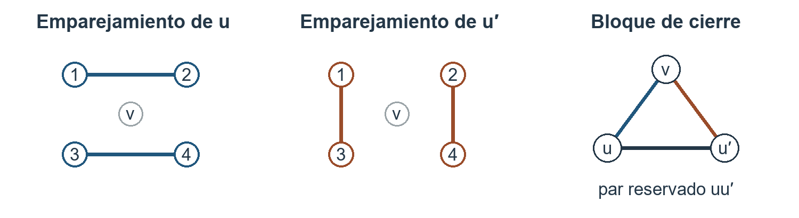

# Una demostración de la conjetura de Colbourn–Dinitz–Rosa

**Juan Pablo Traverso Gianini**  
Investigador independiente, Santiago, Chile  
[jtraverso@gmail.com](mailto:jtraverso@gmail.com)  
[ORCID: 0009-0003-6068-4096](https://orcid.org/0009-0003-6068-4096)

**Artículo II. Bicoloraciones de sistemas triples de Steiner.**  
**Preprint 1.0 — 6 de noviembre de 2026.**

## Resumen

En 1999, Colbourn, Dinitz y Rosa construyeron todos los perfiles admisibles de orden menor que 1000 y conjeturaron que todo perfil admisible se puede realizar [1]. Demostramos esa conjetura. Tres tamaños positivos prescritos se realizan mediante una 3-bicoloración estricta de un sistema triple de Steiner si y solo si cumplen la congruencia del orden, la identidad de pares y la exclusión de dos clases de tamaño dos. La prueba combina el producto de Colbourn, Dinitz y Rosa con construcciones por coloración de aristas. Para el grafo regular restante usamos el teorema de Chetwynd y Hilton; para las familias más estrechas usamos los resultados de Plantholt, de Cao, Chen, Jing y Shan y de coloración que distingue vértices. Un barrido aritmético exhaustivo reduce la base finita a 49 perfiles de orden a lo sumo 487. Su existencia se deduce del Teorema 2.6 de [1].

## 1. El problema de los tamaños de clase

Un sistema triple de Steiner consta de un conjunto de puntos y de ternas, llamadas bloques, tales que cada par no ordenado pertenece exactamente a un bloque. Una 3-bicoloración estricta divide los puntos en tres clases no vacías; cada bloque contiene dos puntos de un color y uno de otro. Podemos elegir el sistema para realizar la partición dada. Colbourn, Dinitz y Rosa construyeron los perfiles admisibles de orden menor que 1000 y preguntaron si, para todo orden, se puede realizar *cada* perfil admisible (Teorema 2.6 y Conjetura 2.7 de [1]). Su teorema 2.8 también garantiza alguna bicoloración para una familia de órdenes descrita por sus factores primos. La conjetura pide realizar cada elección admisible de tamaños para el orden dado. En 2002, Dinitz y Stinson dieron una construcción por producto directo singular y retomaron el problema abierto como su Conjetura 1.4 [2]. Dummit estudió las restricciones aritméticas de los perfiles posibles [3]. Una línea posterior de trabajo extendió bicoloraciones mediante una construcción por duplicación [4]. En las fuentes consultadas no hemos encontrado una demostración anterior que abarque todos los perfiles admisibles de tres clases. El teorema 1 proporciona esa construcción.

**Teorema 1.** Sean $a,b,c$ enteros positivos y $n=a+b+c$. Existe un sistema triple de Steiner con una 3-bicoloración estricta de tamaños de clase $a,b,c$ si y solo si
$$n\equiv1,3\pmod6,\qquad a^2+b^2+c^2-ab-ac-bc=n,$$
y no hay dos entradas iguales a 2. Llamaremos admisible a un perfil que cumpla estas condiciones.

**Mapa de casos.** Ordenemos $a\le b\le c$, pongamos $x=b-a$, $y=c-b$ y procedamos por inducción fuerte en $n$. Se aplican las filas en este orden.

| Condición | Construcción |
|---|---|
| $n<5059$ | Malla finita y CDR [1, Teo. 2.6], §5. |
| $c$ par, $x=1$ | Coloración cíclica, lema 5.2. |
| $c$ par, $x\ne1$ | Coloración equitativa en el orden $(a,b,c)$, lema 5.1. |
| $c$ impar, $x\ge6$ | Coloración equitativa en el orden $(a,c,b)$, lema 5.1. |
| $c$ impar, $x=4$ | Pares faltantes distintos, lema 5.3. |
| $c$ impar, $x=0,2$ | Descenso compuesto o diferencia dos en orden primo, lema 5.4. |

**Necesidad.** Cada bloque que pasa por un punto fijo cubre dos de sus $n-1$ vecinos, de modo que $n$ es impar. Al contar todos los pares se obtienen $n(n-1)/6$ bloques, un número entero. De aquí salen las dos clases de residuos módulo seis. Por otra parte, cada bloque contiene exactamente un par del mismo color. Luego
$$\binom a2+\binom b2+\binom c2=n(n-1)/6.$$
Multiplicar por seis y sustituir $n=a+b+c$ da la identidad cuadrática del enunciado.

Supongamos que $A$ y $B$ tienen dos puntos cada una. Sus cuatro pares entre clases solo se pueden cubrir con bloques $AAB$ y $ABB$. Cada tipo puede aparecer a lo sumo una vez, pues la clase repetida tiene un único par interno. Necesitaríamos, por tanto, un bloque de cada tipo. El punto de $B$ elegido en el primero y el punto de $A$ elegido en el segundo aparecerían juntos dos veces. Esto descarta el perfil. Entre las soluciones positivas de la identidad cuadrática la excepción es $(2,2,5)$ salvo permutación: al poner $a=b=2$ resulta $c^2-5c=0$.

## 2. Las diferencias entre tamaños y la construcción por producto

Ordenemos los tamaños de modo que $a\le b\le c$. Escribamos $x=b-a$, $y=c-b$. El doble de la expresión cuadrática del teorema 1 es la suma de los cuadrados de las tres diferencias. Sustituir $x,y,x+y$ da
$$n=x^2+xy+y^2,\qquad 3a=n-2x-y,\quad b=a+x,\quad c=b+y.$$
Por ejemplo, $x=2,y=3$ da $n=19$ y el perfil $(4,6,9)$. Una cosa es que la forma cuadrática represente un orden. Para realizar cada perfil positivo que se obtiene de ella hace falta construir los bloques.

La forma es la norma de $x-y\omega$, donde $\omega^2+\omega+1=0$. Si un primo $p\equiv5\pmod6$ divide la norma, divide a $x$ y a $y$. En efecto, si $y$ fuera invertible módulo $p$, el cociente $x/y$ resolvería $z^2+z+1=0$. Tendríamos una raíz cúbica de la unidad distinta de 1 en un grupo de orden $p-1\equiv1\pmod3$. Por otra parte, si $p\mid y$, la ecuación da directamente $p\mid x$. Dividir ambos por $p$ extrae un factor $p^2$ de la norma. Repitiendo el argumento se obtiene la conocida condición de exponente par. Dummit [3] estudia qué tamaños de clase admite la aritmética para órdenes primos y cuadrados de primos. Una vez conocidos los tamaños, el producto que sigue permite construir sistemas que los realizan.

**El paso por producto [1].** Supongamos que un sistema interior tiene tamaños $(a,b,c)$, todos a lo sumo la mitad de su orden, y que otro sistema, exterior, tiene tamaños $(u,v,w)$. Pongamos una copia del sistema interior sobre cada punto exterior. Al color interior le restamos el exterior módulo tres. Al agrupar los puntos según esta diferencia obtenemos los tamaños
$$(ua+vb+wc,\;ub+vc+wa,\;uc+va+wb).$$
Los pares internos de cada copia ya tienen bloque. Para cada bloque exterior usamos un cuadrado latino en las tres copias que corresponden a sus puntos. Una vez fijados dos puntos en copias distintas, la condición latina determina el tercero. Así, cada par entre copias queda cubierto una vez, pues su par exterior pertenece a un único bloque. El lema de los cuadrados latinos con entradas prohibidas de [1] usa la cota sobre los tamaños interiores para evitar que la suma de los tres colores sea cero módulo tres. Tres residuos suman cero exactamente cuando los tres son iguales o los tres son distintos. Cada bloque transversal tiene, por tanto, dos colores.

**Lema 2.1 (descenso en orden compuesto).** Sea $n>49$ compuesto y sea $(a,b,c)$ un perfil admisible de orden $n$. Salvo permutación, o bien $n=p^2$ para un primo $p\equiv2\pmod3$ y $(a,b,c)=E(p)$, o bien el perfil es el producto CDR de un perfil interior admisible de orden $m_1$, con todas sus clases de tamaño a lo sumo $m_1/2$, y de un perfil exterior de orden $m_2=n/m_1$, donde $1<m_1,m_2<n$. El perfil exterior es admisible, o bien $m_2=3$ y es la terna auxiliar $(0,1,2)$. Aquí
$$E(p)=\bigl(p(p-2)/3,\ p(p+1)/3,\ p(p+1)/3\bigr).$$
Por tanto, las realizaciones en órdenes admisibles menores, junto con los perfiles $E(p)$, implican la realización en orden $n$.

*Demostración.* En coordenadas de Eisenstein, el producto CDR multiplica las codificaciones, salvo permutación de clases. Hay cuatro elecciones de factor, consideradas en el siguiente orden. Si $3\mid n$, tomamos primero el factor de norma tres por fuera, de modo que $m_2=3$ y no 9. En los casos posteriores $3\nmid n$, por lo que el orden exterior tampoco es 9; en consecuencia, no puede decodificarse como el perfil excluido $(2,2,5)$. Un factor 3 proporciona la terna exterior $(0,1,2)$, cuyo único bloque sigue usando dos colores. Un primo inerte proporciona el perfil interior equilibrado $E(p)$; si su cofactor es una unidad, se obtiene la excepción cuadrada del enunciado. Un primo descompuesto $p\ge13$ proporciona un factor interior de norma $p$. Si solo quedan potencias de 7, la condición $n>49$ permite un factor interior de norma 49. Los argumentos de extracción y decodificación que siguen justifican estas elecciones. La clase mayor de $E(p)$ tiene tamaño par, de modo que la rama de clase mayor par o la base finita proporciona ese perfil sin suponer el resultado en el orden $n$.

Falta justificar la extracción de un factor de norma $p$ cuando $p\equiv1\bmod3$. Trabajamos en los enteros de Eisenstein. Elegimos una raíz cúbica de la unidad no trivial $r$ módulo $p$. Al evaluar la codificación y su conjugada en $r$ se obtiene un producto nulo módulo $p$; por tanto, en una de las raíces $r,r^2$ se anula la codificación. Usamos esa raíz. Entre los pares $(i,j)$ con $0\le i,j\le\lfloor\sqrt p\rfloor$ hay dos que dan el mismo $i+jr$. Su diferencia no nula $(u,v)$ tiene norma múltiplo de $p$ y estrictamente menor que $3p$, pues $|u|,|v|\le\lfloor\sqrt p\rfloor$. La norma no puede ser $2p$: al revisar las paridades de ambas coordenadas se ve que una norma par exige que las dos sean pares, y entonces la norma es múltiplo de cuatro. Obtenemos un elemento $\pi$ de norma $p$ que se anula en la raíz elegida. El núcleo de la evaluación tiene índice $p$ (las constantes enteras dan todos los residuos); el ideal generado por $\pi$ también tiene índice $p$ porque el determinante de la multiplicación es la norma. La inclusión del ideal en el núcleo es, por tanto, una igualdad: $\pi$ divide la codificación. Para el factor tres, la reducción en $\omega=1$ tiene núcleo $(1-\omega)$ de índice tres y $(u+v)^2\equiv0\bmod3$ da la divisibilidad. Quedan justificadas las dos extracciones que usa la fórmula de decodificación.

Veamos cómo se eligen los factores. Codificamos $(u,v)=(a-c,b-c)$ con norma $m=u^2-uv+v^2$. Al invertir las ecuaciones se obtiene $(d+u,d+v,d)$, donde $d=(m-u-v)/3$. El residuo $R(u,v)=u+v\bmod 3$ es multiplicativo, se conserva por conjugación y satisface $R^2=m\bmod3$. Cambiamos a la vez el signo de ambos factores para que el interior tenga $R=m_1\bmod3$; conjugamos el exterior para aplicar la fórmula del producto. Si $m_1=1\bmod3$, la multiplicación determina el residuo exterior. Si $3\mid m_2$, su residuo ya es cero. Ambas ternas son, por tanto, enteras. Cada coordenada se escribe $(m-X)/3$ con $X=u+v,v-2u,u-2v$. Al completar el cuadrado resulta $X^2\le4m$. Para $m\ge7$ esto da positividad. Para $m\ge16$ también da $-2X\le m$, de modo que ninguna clase interior supera $m/2$. Para $13\le m<16$, una excepción exigiría $m=13$ y $X=-7$, incompatible con $X\equiv m\bmod3$. El factor de norma tres se coloca fuera, con terna $(0,1,2)$: el único bloque exterior sigue teniendo dos colores, que es lo que exige la construcción con el cuadrado latino. Si siete es el único divisor primo, extraemos dos factores de norma siete. Su producto tiene norma 49 y da una terna interior equilibrada; la norma restante es al menos siete. Son las comprobaciones de signo y equilibrio de descent_composite.

## 3. Construcción sucesiva de cinco tipos de bloque

Denotemos los tamaños por $A,B,C$ según su *función* en la construcción; pueden estar permutados respecto del orden creciente. Elegimos las funciones de modo que $C$ sea par y construimos un sistema sin bloques $AAC$. Las siguientes hipótesis son suficientes. Sean $E=A(A-1)/2$ y $h=A-2\lfloor E/B\rfloor$. Además de la admisibilidad, supongamos
$$
\begin{gathered}
 C\equiv0\pmod2,\quad A<C,\quad A<B,\quad B-A\text{ impar},\quad B-A\ge3,\\
 6(C-A-1)\le C,\quad 6C\le7A,\quad 6h\le B,\quad B+5\le h+C .
\end{gathered}
$$
En cada punto de $A$ la primera coloración cubre $A-1$ de sus $B$ pares entre clases. Quedan $B-A+1$, un número par, lo que permite emparejarlos. Las cotas $6h\le B$ y $B+5\le h+C$ controlan los dos extremos de las multiplicidades faltantes en la construcción de las filas. La desigualdad $6(C-A-1)\le C$ da margen en la segunda completación; $6C\le7A$ se usa en el grafo regular final.

Los lemas de completación de filas aprovechan el margen de estas desigualdades para elegir emparejamientos sin aristas comunes en conjuntos prescritos. Una fila es el conjunto de pares entre clases que inciden en un punto fijo. La tabla muestra en qué momento se cubre cada par.

**Lema 3.1 (emparejar etiquetas faltantes).** En una coloración propia llamemos multiplicidad de una etiqueta al número de filas donde falta. Supongamos que a cada fila le falta un número par de al menos cuatro etiquetas, que las multiplicidades son $m$ o $m+2$ y que hay al menos $6(m+2)$ etiquetas. Tras recolorear, en cada conjunto de etiquetas faltantes se puede elegir un emparejamiento perfecto sin repetir ningún par entre filas. Se conserva el número de etiquetas de cada multiplicidad (l181_noAnchor).

**Lema 3.2 (completar filas parcialmente emparejadas).** Supongamos que en cada fila de una coloración propia falta un número par de etiquetas. Algunas filas ya tienen emparejamientos perfectos que no repiten ningún par; las demás empiezan sin pares y les faltan al menos cuatro etiquetas. Si toda multiplicidad es a lo sumo $\rho$ y al menos $6\rho$ etiquetas tienen multiplicidad $\rho$, tras recolorear se obtienen emparejamientos perfectos disjuntos en todas las filas y se conserva la multiplicidad de cada etiqueta (l156). En el lema 5.3 emparejamos primero las filas de dos etiquetas: sus pares faltantes son distintos. Las filas de cuatro etiquetas quedan abiertas y se aplica este lema con $\rho=C-A-1=3$. Distinguir esas filas por sí solo no elige dos pares compatibles en cada una.

Ambas pruebas completan una fila cada vez. Elegimos un emparejamiento provisional de tamaño máximo compatible con las demás filas. Si quedan etiquetas sin cubrir, el paso de intercambio recolorea componentes alternantes y aumenta el emparejamiento sin repetir pares ni dejar incompletas las filas cerradas. En el segundo lema la etiqueta auxiliar debe tener multiplicidad $\rho$; las $6\rho$ etiquetas con ese valor dan el margen que requiere stepQ. Cada intercambio aumenta el número de pares, acotado por la mitad del tamaño de la fila. Al cerrarla, disminuye el número de filas abiertas. La sección 6 demuestra el intercambio y cuenta las etiquetas excluidas.

| Bloques añadidos | Elección | Pares cubiertos |
|:--|:--|:--|
| $AAB$ | Colorear propia y equitativamente las aristas de $A$ con los puntos de $B$. | Todos los pares $AA$ y dos pares $AB$ por arista. |
| $ABB$ | Para cada punto de $A$, emparejar los puntos de $B$ que faltan en su fila. | Los demás pares $AB$ y un par $BB$ por bloque. |
| $BBC$ | Colorear las aristas $BB$ libres con los puntos de $C$. | Los demás pares $BB$ y parte de $BC$. |
| $BCC$ | Para cada punto de $B$, emparejar los puntos de $C$ que faltan, sin reutilizar aristas. | Los demás pares $BC$ y algunos pares $CC$. |
| $ACC$ | Dividir las aristas $CC$ restantes en emparejamientos perfectos indexados por $A$. | Los demás pares $CC$ y todos los pares $AC$. |

Usamos el teorema de coloración de aristas de Vizing y el reequilibrio equitativo [5,6]. Colorear las aristas de forma propia significa que dos aristas que se tocan llevan colores distintos. Así, las aristas de un color forman un emparejamiento. Por eso dos aristas con el mismo tercer punto no repiten un par entre clases. En una coloración equitativa, los tamaños de las clases de aristas difieren a lo sumo en uno. Si en la etapa $AAB$ un color se usa en $j$ aristas, le faltan $A-2j$ incidencias en $A$. Los dos valores posibles difieren en dos. El primer lema de completación de filas trata esas multiplicidades. Al elegir emparejamientos disjuntos en aristas se evita gastar dos veces un par $BB$.

En la tercera etapa quedan $C(A+B+1-C)/2$ aristas $BB$. En efecto, los bloques $AAB$ cubren $2E$ pares entre clases y los bloques $ABB$ consumen por tanto $(AB-2E)/2$ pares internos de $B$. Restar esa cantidad de $\binom B2$ y aplicar la identidad cuadrática da la expresión anunciada. Como $A+B+1-C$ es par, la coloración equitativa asigna exactamente $(A+B+1-C)/2$ aristas a cada color. A cada punto de $C$ le faltan entonces $B-(A+B+1-C)=C-A-1$ puntos de $B$. El segundo lema de completación da los bloques $BCC$. Cada una de esas incidencias consume una arista $CC$ en el punto considerado, que queda con grado $(C-1)-(C-A-1)=A$.

El grafo restante es regular de grado $A$ sobre $C$ puntos. Aplicamos el resultado de factorización para orden par: un grafo simple regular sobre $N$ puntos, con $N$ par y grado $d\ge6N/7$, admite una 1-factorización [7]. La desigualdad $6C\le7A$ es exactamente esta hipótesis. A cada uno de los $A$ emparejamientos perfectos se le asigna un punto distinto de $A$ como tercer punto. Cada punto de $C$ aparece una vez en ese emparejamiento, así que se cubre cada par $AC$ requerido. La última columna de la tabla muestra que hemos realizado el perfil.

**La construcción en orden 331.** Tomemos $(A,B,C)=(100,121,110)$, en el orden que usa la tabla. Aquí $E=4950$, $\lfloor E/B\rfloor=40$ y $h=20$. En la primera etapa cada color se usa en 40 o 41 aristas, por lo que faltan 20 o 18 incidencias por color. Quedan por cubrir $100\cdot121-2\cdot4950=2200$ pares entre clases. La segunda etapa gasta entonces 1100 pares internos de $B$. De los $\binom{121}{2}=7260$ pares de esa clase quedan 6160. Al repartirlos entre los 110 puntos de $C$ corresponden 56 aristas a cada color. A cada punto de $C$ le faltan ahora $121-2\cdot56=9$ puntos de $B$. Al completar esos pares se gastan nueve aristas en cada punto de $C$ y queda grado $109-9=100$. El último grafo tiene 110 vértices y cumple $6\cdot110\le7\cdot100$. Se asigna cada uno de sus 100 emparejamientos perfectos a un punto de $A$. Por eso la factorización se aplica al final, una vez completadas las filas anteriores.

## 4. La familia con diferencia dos y el último par que falta

Supongamos que el orden es primo y al menos 5059, que $c$ es impar y que $b=a+2$. Al sustituir $x=2$ en las ecuaciones de la sección 2 se obtiene $3a=y(y+1)$ y $n=y^2+2y+4$. Aquí $a,b$ son pares e $y$ es impar. Si $3\mid y+1$, entonces $3\mid n$, imposible para ese primo. Por tanto $y=6k+3$, de donde
$$a=12k^2+14k+4,\quad b=a+2,\quad c=12k^2+20k+9.$$
La construcción funciona para todo $k\ge4$, incluso para los órdenes compuestos de esta familia. Con $k=4$ se obtiene $(252,254,281)$, de orden 787.

**Lema 4.1 (el empaquetamiento inicial).** Reservemos un emparejamiento perfecto en $A$. Un empaquetamiento inicial de tipos $AAB,ABB,BBC,BCC$ deja libres exactamente el emparejamiento $AA$ reservado, todos los pares $AC$ y un grafo $F$ de pares $CC$. El lema de empaquetamiento elige un punto $w$ y otros $3k+1$ puntos de $C$ de modo que los grados en $F$ sean $6k+2$ en $w$, $a-2$ en esos otros puntos y $a$ en los demás.

El cálculo de grados tiene una interpretación directa. Tras reservar el emparejamiento, la etapa A colorea las aristas $AA$ restantes y empareja las etiquetas faltantes de $B$ en cada fila. La etapa B colorea equitativamente las aristas $BB$ restantes con $c-1$ etiquetas, dejando $w$ sin usar. Su multiplicidad faltante es por tanto $b$. Para cada otra etiqueta, la multiplicidad es $b$ menos el doble del tamaño de su clase de aristas. Los tamaños difieren en uno; la división del total de aristas da $3k+1$ clases menores. En ellas faltan $6k+6$ incidencias frente a $6k+4$ en las otras. El lema de filas con etiqueta fija empareja las etiquetas faltantes de la etapa B asignando a $w$ compañeros distintos. Cada incidencia faltante consume una arista en su etiqueta en $K_C$. Al restar las tres multiplicidades de $c-1$ se obtienen precisamente los grados en $w$, en el conjunto distinguido y en los demás puntos. Los pasos de emparejamiento y recoloración se demuestran en stageA y stageB del archivo común.

Esta distribución permite aplicar el lema de coloración que da una coloración de sus aristas con $a$ colores en la que ningún color se repite en un vértice. Al eliminar $w$ quedan $\delta\ge a-3$ y $\Delta\le a$, luego $7(3\delta-\Delta)\ge14a-63$. Basta por ello que $12(c-1)\le14a-63$ para aplicar el criterio de Plantholt. Al sustituir los valores de $a,c$ se obtiene $14a-12(c-1)-63=24k^2-44k-103$. Sus dos condiciones numéricas vienen de la cota para grafos críticos [8] y del criterio de subgrafos con exceso de aristas en grafos densos [9,7]. Con $6/7$ se reducen, respectivamente, a
$$12k^2-46k-8\ge0,\qquad 24k^2-44k-103\ge0.$$
En $k=4$ los lados izquierdos valen 0 y 105. Ambos crecen a partir de allí. Las demás condiciones del empaquetamiento ya se satisfacen desde ese valor. Este es el caso base de la familia: al aumentar $k$ en uno, los lados izquierdos aumentan en $24k-34$ y $48k-20$.

1. Quitamos $w$ y escribimos $N=c-1$. Si el grado máximo restante es menor que $a$, bastan $a$ colores por Vizing. En otro caso $\Delta=a$ y $\delta\ge a-3$. El criterio para orden par que usamos dice que, si $12N\le7(3\delta-\Delta)$, el grafo requiere más de $\Delta$ colores exactamente cuando algún conjunto impar contiene más de $\Delta(|S|-1)/2$ aristas. La hipótesis se cumple porque $14a-63-12(c-1)=24k^2-44k-103\ge0$. Para justificar que un conjunto con exceso tiene que omitir un vértice, sea $S$ impar y pongamos $t=N-|S|$. Si $|S|\le a$, la comparación con el grafo completo descarta el exceso. En otro caso, si $t\ge3$, se tiene $3\le t\le N-a-1=6k+3$ y
$$2e(S)\le a|S|-e(S,\overline S),\qquad e(S,\overline S)\ge t(\delta-t+1)\ge t(a-t-2).$$
   El exceso exigiría que el corte fuese menor que $a$. La última cuadrática es cóncava en $t$. En los extremos toma los valores $3(a-5)\ge a$ y $(6k+3)(a-6k-5)\ge a$ para $k\ge4$, una contradicción. Solo queda $t=1$. Pongamos $H=F-w$. El patrón de grados del Lema 4.1 da $2e(H)=aN-12k-4$. Para todo $z\in V(H)$,
   $$2e(H-z)=aN-12k-4-2d_H(z)\le a(N-2)-12k+2\le a(N-2),$$
   pues $d_H(z)\ge a-3$. Estos conjuntos tampoco tienen exceso.
2. Volvemos a $F$. Para conjuntos impares que evitan $w$, la cota de aristas se deduce de la coloración anterior. Para los de tamaño a lo sumo $a$ basta comparar con un grafo completo. Para los conjuntos mayores que contienen $w$, se obtiene la misma cota contando el déficit de grados en el complemento.
3. Si $F$ exigiera más de $a$ colores, tomamos un subgrafo crítico sobre sus vértices incidentes. Contiene a $w$, tiene grado máximo $a$ por Vizing y grado mínimo a lo sumo $6k+2$. Su orden $N'$ está entre $a+1$ y $c$.
4. El teorema 1.2 de CCJS [8] garantiza exceso de aristas en un grafo crítico cuando $3N'+7\delta'\le4\Delta'+17$ y $N'+\delta'\ge27$. La segunda condición se deduce de $a\ge252$. Para la primera usamos $4a+17-3c-7(6k+2)=12k^2-46k-8\ge0$.
5. Los vértices de un subgrafo con exceso formarían uno de los conjuntos impares excluidos en el paso 2. Esta contradicción da una coloración propia de $F$ con $a$ colores.

¿Por qué basta una coloración propia? Respecto del grado $a$, la suma de los déficits es
$$[a-(6k+2)]+2(3k+1)=a.$$
Luego $2|E(F)|=ac-a=a(c-1)$. Como $c$ es impar, cada uno de los $a$ colores forma un emparejamiento de tamaño a lo sumo $(c-1)/2$. La suma alcanza el máximo posible. Cada color deja entonces sin cubrir exactamente un punto de $C$. En un punto $v$ faltan precisamente $a-\deg_F(v)$ colores, un número par en cada vértice. Emparejemos los colores que faltan en cada punto y pongamos sus parejas en biyección con el emparejamiento reservado en $A$.

Asignemos a cada emparejamiento el punto $u$ de $A$ que le corresponde y añadamos $u$ a sus aristas para formar bloques $ACC$. Si los emparejamientos de $u,u'$ dejan sin cubrir el mismo punto $v$, añadimos el bloque $\{u,u',v\}$. Este bloque cubre el par reservado $uu'$ y los dos últimos pares entre clases, $uv,u'v$. Cada par reservado se usa una vez y cada par entre clases pendiente tiene un único bloque que lo cubre. La figura 1 muestra el último paso para dos emparejamientos. El mismo procedimiento sirve si en ese punto faltan más colores.

## 5. Por qué los casos cubren todos los órdenes

**Lema 5.1 (ramas equitativas).** Para $n\ge5059$ se aplica el criterio de la sección 3 en el orden indicado si $c$ es par y $x\ne1$, o si $c$ es impar y $x\ge6$.

*Demostración.* Sea $s=x+y$. Como $n\le s^2$ y $71^2<5059$, tenemos $s\ge72$. De $n=s^2-xy\ge3s^2/4$ y $3a=n-2x-y$ se deduce $a\ge s^2/4-2s/3\ge17s$. Pongamos $A=a$, $B=a+t$, $C=a+u$. En el primer caso $(t,u)=(x,s)$; en el segundo, $(t,u)=(s,x)$. Como $n$ es impar, hay una o tres clases impares; la identidad cuadrática excluye tres por paridad. Así $C$ es par y $t$ impar. En ambos casos $t\ge3$, $u>0$, y $a\ge17s$ da $6(u-1)\le C$ y $6C\le7a$.

Quedan las dos desigualdades que contienen $h$. La división da
$$\frac{a(a-1)}{a+t}=a-t-1+\frac{t(t+1)}{a+t}.$$
La última fracción crece con $t\ge0$ y en $s$ es menor que cuatro, pues $a+s\ge s^2/4+s/3$. De $h=a-2\lfloor a(a-1)/(2B)\rfloor$ se deduce $t-3<h<t+3$. Luego $6h\le B$. Para la última desigualdad basta $h\ge t+5-u$. Si $u\ge8$, esto se sigue directamente. Solo queda $u=x=6$: tanto $a$ como $h$ son pares y $t$ es impar, de modo que $h>t-3$ obliga a $h\ge t-1$. Esto cubre tanto $y=0,1$ como $y\ge2$ cuando la clase mayor es par. Las ramas formales son master_y0, master_y1, master_l157 y branchL161_of.

**Lema 5.2 (rama cíclica).** Un perfil admisible con $B=A+1$, $C$ par, $4\le A$, $A+4\le C$, $6(C-A-1)\le C$ y $6C\le7A$ tiene una realización (x1_realises). En el orden creciente escribimos $A=a$ y $C=a+1+y$. Como $3a=y^2-1$, las dos cotas de grado se reducen a $y^2-15y+2\ge0$ y $(y-19)(y+1)\ge0$. Para $y$ entero positivo se cumplen desde 15 y 19, respectivamente. Por tanto, basta que $y\ge19$, cualquiera que sea el orden. Para los órdenes grandes se cumple automáticamente porque $n=1+y+y^2$; en la rama finita se verifican directamente las cotas de grado. A cada punto de $A$ le faltan exactamente dos etiquetas de las $B=a+1$. Para $a$ impar numeremos los puntos módulo $a$ y coloreemos $ij$ con $i+j$, dejando un color adicional. En $i$ faltan $2i$ y el color adicional; estos pares son distintos. Para $a$ par usemos los residuos módulo $a+1$ y el infinito: la arista $ij$ recibe $i+j$ y la de infinito a $i$ recibe $2i$. Quitamos 0 y 1. En cada residuo restante falta el par $\{i,i+1\}$, y en infinito falta $\{0,2\}$. Todos son distintos. Cada par faltante da un bloque $ABB$. Las hipótesis permiten ahora completar las filas restantes y aplicar la factorización final de la sección 3.

**Lema 5.3 (diferencia cuatro).** Para $c$ impar y $x=4$ e $y\ge17$, tomemos $A=a$, $C=a+4$, $B=C+y$. Se cumple $3a=y^2+3y+8$ e $y$ es impar. Este intervalo incluye casos de la base: $y=17$ da orden 373. Para $n\ge5059$ la hipótesis es automática, pues $y\le16$ daría $n=16+4y+y^2\le336$. Sea $k=(y^2-1)/6$. La primera coloración equitativa usa cada etiqueta en $k$ o $k+1$ aristas: el número $r$ de clases menores es $B(k+1)-\binom a2=(y^2-3y+20)/6$, entre cero y $B$. Las multiplicidades faltantes son $a-2k=y+3$ e $y+1$. El primer lema de filas se aplica porque $6(y+3)\le B$ por la fórmula de $a$. En el grafo restante sobre $B$ hay $r$ vértices de grado $C-4$ y $B-r$ de grado $C-2$.

BKLS [10, Cor. 12] da una coloración propia que distingue vértices con a lo sumo $k_0+1$ colores si el grado mínimo es al menos 5 y $(\Delta-4)^2\ge2B$, donde $k_0$ es el menor entero tal que $\binom{k_0}{d}\ge n_d$ para cada multiplicidad de grado $n_d$. Aquí $\Delta=C-2$, $C-4=a\ge116$ y $B=C+y$, así que las cotas de grado se deducen de $3a=y^2+3y+8$. Con $C-1$ colores las capacidades para los dos grados son $\binom{C-1}3$ y $C-1$. Ambas multiplicidades son a lo sumo $C-1$ por la fórmula de $r$; como $B-r>1$, con $C-2$ colores no basta. Luego $k_0=C-1$. Rudašová y Soták [11, Teo. 3.1] dan una coloración equitativa que distingue vértices con $C$ colores. Los conjuntos distintos de colores incidentes tienen complementos distintos; así, las filas donde faltan dos etiquetas pueden usar esos pares sin repetirlos. Se aplican la completación y la factorización de la sección 3 ($C-A-1=3$, $6C\le7A$). Esta rama es x4_core. El teorema de Rudašová y Soták asegura precisamente que exigir equidad conserva el número mínimo de colores que distinguen los vértices.

**Lema 5.4 (últimas dos diferencias).** Si $c$ es impar y no se aplican las ramas anteriores, $a,b$ son pares, por lo que $x=0$ o 2. En orden compuesto se aplica el descenso de la sección 2 por inducción fuerte; sus perfiles cuadrados auxiliares tienen clase mayor par y se obtienen del lema 5.1 o de la base finita. En orden primo $x=0$ daría $n=y^2$. Para $x=2$, la sección 4 da $y=6k+3$. Si $k<4$, entonces $n=y^2+2y+4\le487$. Por tanto la sección 4 proporciona la realización. Esto prueba el paso inductivo. El corte 5059 basta para todas las ramas: obliga a $s\ge72$ y sitúa los casos cíclico y de diferencias cuatro y dos por encima de sus propios umbrales. No se requiere que sea óptimo.

Queda justificar la base de la inducción. Para $n<5059$, la fórmula de la norma da $0\le x,y<72$, pues $72^2>5059$. Recorremos los pares enteros de ese cuadrado. Calculamos $n=x^2+xy+y^2$ y recuperamos $a=(n-2x-y)/3$. Conservamos solo perfiles enteros, positivos y admisibles en el intervalo de órdenes descrito. Cada perfil ordenado aparece una sola vez porque determina sus diferencias. Se obtienen 1551 perfiles. Dentro del cuadrado se pueden aplicar las construcciones desde sus respectivos umbrales. Para órdenes compuestos mayores que 49, el mismo descenso funciona por inducción dentro de la base. Una vez aplicadas las construcciones y el descenso, quedan 49 perfiles que se resuelven con el teorema publicado para órdenes pequeños, todos de orden a lo sumo 487.

El Teorema 2.6 de Colbourn, Dinitz y Rosa [1] realiza cada uno de estos 49 perfiles. Su resultado trata los órdenes menores que 1000 con la condición de factores primos de su Teorema 2.2 y la identidad de la partición; el párrafo precedente exige la condición sobre clases de tamaño dos. Nuestros perfiles cumplen la condición de primos por la sección 2 y excluyen dos clases de tamaño dos. Queda así cubierta la base de la prueba escrita. El apéndice describe las tablas independientes. CDR describen una búsqueda con el algoritmo de ascenso local de Stinson. Su artículo no reproduce los sistemas individuales. Nuestro archivo incluye tablas verificables para los 49. Los cinco órdenes de la rama cíclica en la malla son 1483, 1723, 2551, 3541 y 3907; el lema 5.2 se aplica a los cinco. El reparto entre cinco casos cíclicos y 49 tablas obedece a la regla de la malla: envía (133,134,154) a una tabla porque su orden, 421, es menor que 508, aunque también se le aplica el lema 5.2.

El siguiente recuento permite reproducir el paso finito. Se recorren las filas de arriba abajo y se asigna cada perfil a la primera construcción aplicable. Aunque admita dos construcciones, se cuenta solo una vez.

| Primer paso aplicable para $n<5059$ | Perfiles |
|:--|--:|
| Descenso en orden compuesto (los perfiles cuadrados especiales se tratan por separado) | 1201 |
| Construcción equitativa en alguno de los seis órdenes de las clases | 287 |
| Primera etapa cíclica | 5 |
| Diferencia cuatro | 5 |
| Diferencia dos | 4 |
| CDR [1, Teo. 2.6] | 49 |
| **Total** | **1551** |

La tabla suplementaria [S1] enumera los 1551 perfiles e indica qué construcción se aplica a cada uno.

La suma de la última fila abarca todos los pares de diferencias admisibles del intervalo finito. Los perfiles de la última rama quedan dentro del intervalo de [1, Teorema 2.6], y cada rama anterior aplica una construcción o reduce el orden. La inducción fuerte demuestra así el teorema 1. El corte en 5059 separa la malla finita de la construcción uniforme de existencia. El artículo I prescribe además el número de bloques de un tipo y obtiene un umbral existencial para esa otra conclusión.

## 6. Los intercambios que completan las filas

El Lema 3.1 es el caso sin ancla con $\rho=m+2$; el Lema 3.2 es el caso de multiplicidad fija. La variante anclada de la sección 4 reserva el compañero prescrito al efectuar los mismos intercambios.

**Cómo intercambiar una etiqueta faltante con una presente.** Supongamos que en una fila falta $p$, todavía sin emparejar, y que $x$ está presente. Intercambiar $p,x$ en una sola arista podría repetir un color en otra fila. Para determinar qué filas han de cambiar juntas, dibujamos dos marcas por fila, una para $p$ y otra para $x$, y las unimos. A través de cada arista de uno de esos colores unimos las marcas del mismo color. Por último, enlazamos marcas distintas si dos filas diferentes ya usan pares $pz$ y $xz$ con un mismo compañero $z$. Cada marca tiene su enlace interno y a lo sumo otro: un color presente aparece una sola vez, un color faltante tiene a lo sumo un compañero y el par con ese compañero pertenece a lo sumo a otra fila. Las componentes son caminos o ciclos. Intercambiamos los colores en toda una componente, incluidos los pares de sus filas. Los enlaces entre marcas iguales conservan la propiedad de la coloración; los enlaces entre marcas distintas evitan que dos pares se vuelvan iguales. Una fila cerrada conserva su emparejamiento perfecto.

Un extremo es una marca faltante sin enlace externo. En cada componente, el número de marcas faltantes $p$ menos el de marcas faltantes $x$ es la diferencia entre los números de extremos de esos dos tipos: cada enlace entre marcas faltantes cuenta una de cada tipo. La componente del $p$ aún sin pareja en la fila elegida es un camino. Su diferencia de extremos es cero o dos. En el segundo caso, si la multiplicidad de $x$ es al menos la de $p$, la diferencia total es no positiva, de modo que hay otra componente con dos extremos $x$. Intercambiamos ambas. En otro caso las multiplicidades son los niveles bajo y alto del lema 3.1, e intercambiar solo la primera componente permuta esos niveles. Esto prueba las afirmaciones sobre multiplicidad. En el lema 3.2 elegimos $x$ de multiplicidad máxima para que siempre se aplique la primera alternativa. Aparte del de la fila elegida, ha podido cambiar a lo sumo un extremo libre $p$; la componente compensadora no tiene ninguno. Por ello puede ocuparse a lo sumo un par antes libre de $x$ con los compañeros protegidos. Los pares ajenos a $p$ y a $x$ conservan su estado.

**Por qué hay suficientes etiquetas y por qué se termina.** Sea $S$ el conjunto aún sin emparejar en la fila abierta. Elegimos en $S$ un emparejamiento $T$ de tamaño máximo entre los pares que no se han usado. Supongamos que quedan $d_0\ge2$ puntos libres y llamemos $\rho$ a la multiplicidad máxima. Cada punto libre tiene a lo sumo $\rho-1$ vecinos usados, pues en esta fila aún falta. Todos los pares de puntos libres están usados, o se podría ampliar $T$. Para cada $ab\in T$ hay al menos $d_0$ incidencias usadas entre los puntos libres y $a,b$: en otro caso dos puntos libres distintos permitirían sustituir $ab$ por dos pares libres (si ambos solo pudieran usar el mismo extremo, el otro extremo ya aportaría $d_0$ incidencias usadas). Al contar en los puntos libres resulta $d_0(d_0-1)+d_0|T|\le d_0(\rho-1)$. Así $d_0+|T|\le\rho$ y $|S|=d_0+2|T|\le2\rho-2$.

Sin par fijado de antemano, disponemos de al menos $6\rho$ etiquetas. Excluimos las del conjunto de la fila y los vecinos ya usados de a lo sumo cuatro etiquetas designadas, libres o emparejadas provisionalmente. Se descartan a lo sumo $|S|+4(\rho-1)<6\rho$ elecciones. Si hay que respetar las multiplicidades individuales, elegimos solo entre las etiquetas de multiplicidad $\rho$. Si en esta fila hay un par fijado de antemano, excluimos también sus dos extremos y la desigualdad sigue siendo estricta. Los intercambios trasladan los pares existentes y evitan el color fijo. En particular, los pares que contienen la etiqueta común siguen siendo disjuntos.

Si $T$ está vacío hay al menos cuatro puntos disponibles. Tomamos $p,u,v$ libres y una etiqueta $x$ libre de conflictos con los tres; intercambiamos la etiqueta faltante $p$ por $x$. A lo sumo uno de $xu,xv$ ha pasado a estar usado, así que añadimos el otro. Si $T$ no está vacío, tomamos $ab\in T$ y $p,u$ libres. Elegimos $x$ sin conflictos con $p,u,a,b$ y cambiamos $p$ por $x$. Si $xu$ está libre, lo añadimos. Si se ocupó, $xa$ y $xb$ siguen libres. Elegimos ahora $z$ sin conflictos con $u,x,a,b$ y cambiamos $u$ por $z$. Si $xz$ está libre lo añadimos; en otro caso $za,zb$ siguen libres y $xa$ también, pues el segundo intercambio no tocó ninguna de sus etiquetas. Sustituimos $ab$ por $xa,zb$. En cada caso aumenta el número de pares provisionales, que no puede exceder la mitad del tamaño de la fila. Cerramos la fila completada y repetimos en las demás. Quedan probados los pasos de completación de la sección 3 y la variante con etiqueta fija usada en la sección 4.

**La etiqueta fija y el conteo de conjuntos impares de la sección 4.** Sea $K_0=6k^2+4k+1$. En la etapa A, al quitar un emparejamiento perfecto de $K_A$ queda un grafo de grado $a-2$; su coloración equitativa con $a+2$ colores da cuatro colores faltantes por fila y multiplicidades dos o cuatro. En el grafo restante sobre $B$, cuatro vértices tienen grado $a-1$ y los demás $a-3$. Hay $(c-1)K_0-(3k+1)$ aristas para $c-1$ colores, así que exactamente $3k+1$ clases tienen tamaño $K_0-1$. Para emparejar el color omitido $w$ en cada fila tomamos como compañeros posibles los demás colores que faltan. Cada fila tiene al menos $6k+5$ de ellos y cada color falta en a lo sumo $6k+6$ filas. Cuatro filas tienen $6k+5$ compañeros disponibles; las demás tienen $6k+7$. En cualquier conjunto no vacío de $h\le7$ filas una sola fila ya tiene al menos $h$ compañeros, pues $k\ge4$. Si $h\ge8$ hay al menos $(6k+7)h-8\ge(6k+6)h$ incidencias y cada compañero aparece a lo sumo $6k+6$ veces. La unión contiene al menos $h$ compañeros. El teorema de Hall asigna representantes distintos. Fijamos los pares así obtenidos que contienen a $w$ y aplicamos el intercambio anterior.

Escribimos $s=6k+2$ para el grado de $w$. La suma de grados de $F$ es $a(c-1)$: el déficit en $w$ es $a-s$ y los $s/2$ puntos excepcionales aportan otro $s$. Para $H=F-w$ y $x\in H$,
$$2e(H-x)\le a(c-1)-2s-2(a-3)\le a(c-3).$$
Aquí $s\ge3$. Para cualquier conjunto impar $S$ que contenga $w$ y con $|S|>a$, sea $t=|V(F)\setminus S|$. Como $c+2\le2a$, se tiene $t+3\le a$. En el complemento no está $w$, luego todos sus vértices tienen grado al menos $a-2$. Restamos de $2e(F)$ el doble de la suma de sus grados y volvemos a sumar el doble de sus aristas internas, a lo sumo $t(t-1)$. Resulta
$$2e(S)-a(|S|-1)\le t(t+3-a)\le0.$$
Estas son las dos cotas de conjuntos impares que requiere el paso previo a la aplicación de CCJS.

## Apéndice. La caracterización formal

Se transcriben los enunciados del espacio de nombres CDRBicolour. En la prueba formal congelada, los últimos 49 casos se resuelven con tablas explícitas. El informe registra, además de los tres axiomas estándar, una reducción nativa por tabla que depende del compilador y la ejecución del código compilado. La verificación independiente en Python corrobora los datos sin eliminar esa dependencia de Lean. El informe técnico [S2] identifica cada resultado. El artículo sobre el espectro [12] utiliza el teorema de absorción de [13] para una prescripción distinta.

~~~
theorem cdr_conjecture : CDRConjecture

theorem cdr_characterization {a b c : ℕ} (ha : 0 < a) (hb : 0 < b) (hc : 0 < c) :
    Realises a b c ↔ AdmissibleProfile a b c

theorem cdr_characterization_bicolourable3 {a b c : ℕ} (ha : 0 < a) (hb : 0 < b) (hc : 0 < c) :
    CDR.Bicolourable3 (a + b + c) a b c ↔ AdmissibleProfile a b c
~~~

## Agradecimientos

El autor agradece profundamente a su esposa María Paz y a sus hijos Lucas, Juan Cristóbal, Francisca, Raimundo y Benjamín su amor, paciencia y apoyo.

## Uso de inteligencia artificial y herramientas computacionales

Claude, de Anthropic, y ChatGPT/Codex, de OpenAI, se utilizaron para explorar y comprobar argumentos y para preparar el manuscrito.

Certo [14] y Jacobian [15] se utilizaron para explorar casos finitos, comprobar identidades y evaluar construcciones candidatas. Estos cálculos orientaron el desarrollo de los argumentos; las comprobaciones finitas no se trataron como pruebas de enunciados universales.

El autor es responsable de los argumentos, las citas, el código y la exposición. Ningún sistema de IA figura como autor.

## Referencias

1. C. J. Colbourn, J. H. Dinitz y A. Rosa. Bicoloring Steiner triple systems. *Electronic Journal of Combinatorics* 6 (1999), R25. <https://doi.org/10.37236/1457>.
2. J. H. Dinitz y D. R. Stinson. A singular direct product for bicolorable Steiner triple systems. In *Codes and Designs* (2002), 87–98. <https://cs.uwaterloo.ca/~dstinson/papers/bicoloring.pdf>.
3. D. S. Dummit. CM elliptic curves and bicolorings of Steiner triple systems. *Bulletin of the London Mathematical Society* 34 (2002), 403–410. <https://doi.org/10.1112/S0024609301008785>.
4. M. Gionfriddo, E. Guardo and L. Milazzo. Extending bicolorings for Steiner triple systems. *Applicable Analysis and Discrete Mathematics* 7 (2013), 225–234. <https://doi.org/10.2298/AADM130827019G>.
5. V. G. Vizing. On an estimate of the chromatic class of a p-graph. *Diskretnyi Analiz* 3 (1964), 25–30.
6. C. J. H. McDiarmid. The solution of a timetabling problem. *Journal of the Institute of Mathematics and Its Applications* 9 (1972), 23–34. <https://doi.org/10.1093/imamat/9.1.23>.
7. A. G. Chetwynd y A. J. W. Hilton. Regular graphs of high degree are 1-factorizable. *Proceedings of the London Mathematical Society* (3) 50 (1985), 193–206. <https://doi.org/10.1112/plms/s3-50.2.193>.
8. Y. Cao, G. Chen, G. Jing y S. Shan. The overfullness of graphs with small minimum degree and large maximum degree. *SIAM Journal on Discrete Mathematics* 36 (2022), 2258–2270. <https://doi.org/10.1137/21M1432776>.
9. M. Plantholt. Overfull conjecture for graphs with high minimum degree. *Journal of Graph Theory* 47 (2004), 73–80. <https://doi.org/10.1002/jgt.20013>.
10. P. N. Balister, A. Kostochka, H. Li y R. H. Schelp. Balanced edge colorings. *Journal of Combinatorial Theory B* 90 (2004), 3–20. <https://doi.org/10.1016/S0095-8956(03)00073-X>.
11. J. Rudašová y R. Soták. Vertex-distinguishing proper edge colourings of some regular graphs. *Discrete Mathematics* 308 (2008), 795–802, Teorema 3.1. <https://www.sciencedirect.com/science/article/pii/S0012365X07005237>.
12. J. P. Traverso Gianini. The exact block-type spectrum in the Colbourn–Dinitz–Rosa problem. Artículo I. DOI 10.5281/zenodo.23987251. <https://github.com/jtraverso/cdr-steiner-preprints/blob/v1.0/preprints/PAPER_I/01_manuscript/spectrum_es.pdf>.
13. J. P. Traverso Gianini. Triangle decompositions III: Physical typed absorption and prescribed statistics. Zenodo, v1.0 (2026). <https://doi.org/10.5281/zenodo.23867836>.
14. J. P. Traverso Gianini. Certo. Software. <https://github.com/jtraverso/certo-math>.
15. Jacobian contributors. Jacobian. Software. <https://github.com/morluto/jacobian>.

### Material suplementario

**[S1]** Malla completa por perfil. <https://github.com/jtraverso/cdr-steiner-preprints/blob/v1.0/preprints/PAPER_II/02_validation/finite_grid.csv>.

**[S2]** Informe técnico. <https://github.com/jtraverso/cdr-steiner-preprints/blob/v1.0/preprints/PAPER_II/05_formalization/companion_es.pdf>.
